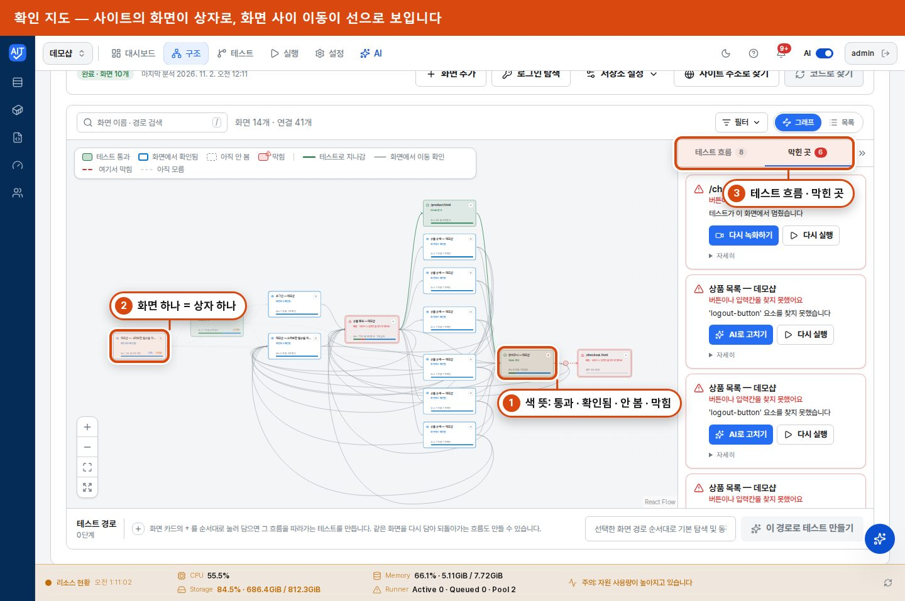
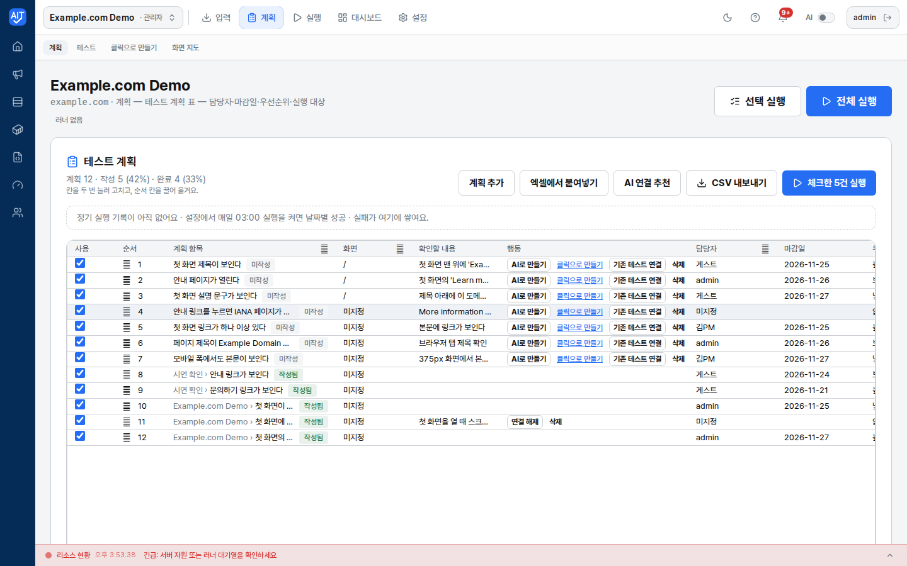
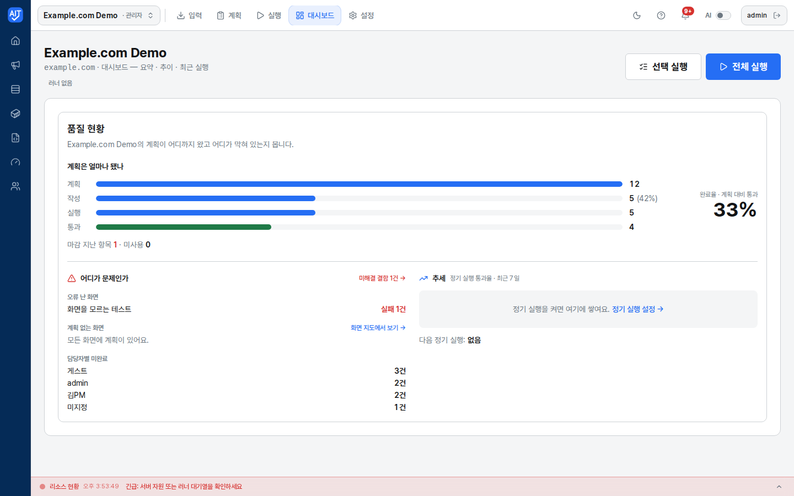

<div align="center">

# AI-TestOps

**Playwright와 생성형 AI로 웹 테스트를 만들고, LangGraph로 테스트를 거듭할수록 똑똑해지는 테스트 운영 플랫폼**

[](https://github.com/digitalist-corp/AI-TestOps/actions/workflows/deploy-test.yml)


[바로 써 보기](https://ai-testops.pages.dev/login) ·
[사용설명서](https://ai-testops.pages.dev/guide/index.html) ·
[빠른 시작](#빠른-시작) ·
[프로젝트 차터](#프로젝트-차터)

</div>

> 배포 주소: https://ai-testops.pages.dev — 계정은 팀에 문의해 주세요.

<p align="center">
  
</p>

## 소개

전담 QA 인력이 없는 개발팀도 자기 서비스를 스스로 검증할 수 있게 만드는 도구입니다.

- **화면을 먼저 이해합니다.** GitHub 저장소 코드나 실제 사이트를 분석해 화면 · 요소 · 이동을 **화면 지도(지식 그래프)** 로 저장합니다. AI는 이 지도에 실제로 있는 요소로만 Playwright 테스트를 만듭니다.
- **계획부터 세웁니다.** "무엇을 테스트할지"를 계획 표에 먼저 적고(엑셀 붙여넣기 가능), 행마다 AI 작성 · 클릭 녹화 · 기존 테스트 연결로 테스트를 잇습니다.
- **테스트할수록 똑똑해집니다.** 실패를 묶어 원인을 5종으로 분류하고, 사람이 승인한 수정을 학습 기억에 쌓아 같은 실패가 오면 다시 씁니다.
- **AI는 사람 승인 없이 아무것도 바꾸지 않습니다.** 모든 수정은 격리된 사본에서 검증한 뒤 승인을 기다립니다.

| 지표 | 결과 |
|---|---|
| 화면 분석 후 생성한 테스트의 무수정 통과 | 6건 중 **5건** (분석 없이 1건) |
| 기준 화면 발견 | 9개 중 **9개** |
| 실패 원인 분류 정확도 | 평가셋 20건 중 **18건 (90%)** |
| 자동 테스트 | **1,103개** (API 653 · 웹 429 · AI 서비스 14 · E2E 7) |

## 주요 기능

<table>
<tr>
<td width="50%" valign="top">

**🗺️ 화면 지도**
- 코드베이스 분석: 저장소에서 라우트 · 화면 파일을 찾아 요소 · 이동 추출
- 사이트 탐색: URL만으로 링크 · 접근성 트리 · 화면 캡처 수집
- 화면 상태 4색(통과 · 확인됨 · 안 봄 · 막힘), 흐름 재생, 막힌 곳에서 바로 수정

**📋 계획 우선 테스트 관리**
- 계획 행 먼저 → AI로 만들기 · 클릭으로 만들기 · 기존 테스트 연결 · AI 연결 추천
- 담당자 · 마감일 · 우선순위, 작성률 · 완료율, CSV 내보내기
- 정기 실행 결과를 날짜별 칸과 7일 통과율로 표시

**▶️ 실행 · 결함**
- 프로젝트별 일회성 Docker 컨테이너에서 Playwright 실행 (수동 · 선택 · 예약)
- 한국어 단계 기록 · 실패 시점 화면 · 영상, 결함 리스트와 실패만 다시 실행
- 진행 중 남은 예상 시간 표시

</td>
<td width="50%" valign="top">

**🧠 테스트할수록 똑똑해지는 AI**
- 실패 서명 · 군집, 원인 5종(제품 결함 · 스크립트 오류 · 환경 · 불안정 · 미분류)
- LangGraph 학습 루프: 분류 → 과거 수정 회상 → 격리 수정 · 재검증 → 사람 승인(interrupt) → 반영 → 재실행
- 제품 결함이면 앱 소스를 진단해 검토용 diff 제안 (팀원 사용권은 PM이 부여)
- 첫 테스트 뒤 결과를 쉬운 말로 정리하는 비전공자 브리핑 (A2UI)

**👥 역할별 화면**
- 관리자 · PM · 팀원 홈이 각각 다름 (전체 현황 / 맡은 프로젝트 / 내 할 일)
- 대시보드는 계획 진척 · 문제 지점 · 추세 세 질문에만 답함
- 공지, 알림, 사용자 관리

**🔒 안전장치**
- AI 변경은 승인 후 반영, 승인 뒤 전체 재실행으로 사후 검증 · 실패 시 되돌림
- 검증을 줄이거나 가짜 화면으로 바꾼 수정은 위험 표시 · 학습에서 제외
- AI 키는 AES-GCM 암호화, LLM 호출은 API 서버 프록시로만

</td>
</tr>
</table>

<p align="center">
  
  
</p>

## 사용 흐름

| 순서 | 누가 | 하는 일 | 어디서 |
|---|---|---|---|
| 1 | 관리자 | 사이트 주소(+ GitHub 저장소)로 프로젝트를 만들고 PM을 지정합니다. 등록 직후 사이트를 탐색해 첫 테스트를 만들고 돌려 봅니다 | 프로젝트 목록 → 새 프로젝트 |
| 2 | 누구나 | 찾은 화면과 확인 상태를 봅니다 | 계획 › 화면 지도 |
| 3 | PM | 계획 항목을 적거나 엑셀에서 붙여넣고, 팀원 · 마감일을 정합니다 | 계획 › 계획 표 |
| 4 | PM | 행마다 AI로 만들기 · 클릭으로 만들기 · 기존 테스트 연결로 테스트를 잇습니다 | 계획 표 · AI › AI 검토 |
| 5 | 팀원 | 배정된 케이스를 실행하고 결과 · 결함을 봅니다 | 홈 · 실행 › 결과 · 결함 |
| 6 | PM | 실패에 AI 루프를 돌리고, 수정안을 보고 승인합니다 | 실행 결과 → AI 루프 패널 |

자세한 사용법 · 용어 · 흐름도는 앱 안 [사용설명서 v3](https://ai-testops.pages.dev/guide/index.html)(`/guide`)에 있습니다.

## 빠른 시작

**필요한 것:** Docker (Desktop 4GB 이상 권장), Node.js

```bash
git clone https://github.com/digitalist-corp/AI-TestOps.git
cd AI-TestOps
cp .env.example .env
```

`.env`에서 두 값을 채웁니다.

- `PLAYOPS_ENCRYPTION_KEY` — `openssl rand -base64 32`로 만든 값. **한 번 정하면 바꾸지 마세요** (저장된 AI 키를 풀 수 없게 됩니다).
- `LOGIN_PASSWORD` — 첫 관리자 계정(`LOGIN_USERNAME`) 비밀번호. 기본 비밀번호로 로그인하면 변경 화면으로 이동합니다.

```bash
npm run dev          # 개발 모드: Web HMR + API 자동 재시작
npm run down:dev     # 종료
npm run logs:dev     # 로그
```

| 서비스 | 주소 |
|---|---|
| Web | http://localhost:3000 |
| API | http://localhost:8080/actuator/health |
| API 디버그 | localhost:5005 |
| PostgreSQL | localhost:5433 |

LangGraph 학습 루프(ai-service)는 선택 기능입니다. 꺼져 있어도 나머지 기능은 그대로 동작합니다.

```bash
docker compose -f docker-compose.dev.yml --profile ai up -d ai-service
```

AI 공급자(Claude · GPT)와 API 키는 관리자가 앱 안 **AI 설정**에서 등록합니다. 운영 모드는 `npm run prod`이며, 두 모드는 같은 컨테이너 이름 · 포트를 쓰므로 하나를 내린 뒤 다른 하나를 올립니다.

### 테스트

```bash
# API (Mac에는 JDK 없이 Docker의 JDK 21 이미지로)
docker run --rm -v "$PWD/apps/api":/app -v api-gradle-cache:/home/gradle/.gradle -w /app \
  gradle:8.10.2-jdk21 ./gradlew test --no-daemon --console=plain

# Web
npm run build --workspace apps/web
```

실패 원인 분류 평가셋은 [`docs/eval`](docs/eval/README.md)에서 재현할 수 있습니다.

## 아키텍처

```text
 Web (React 19)  ──REST──▶  API (Spring Boot 3.3) ──JPA──▶ PostgreSQL 16 (Flyway V1~V26)
                              │  권한 · 승인 게이트 · LLM 프록시 · MCP 도구
                              ├──▶ Runner (Node · Playwright, 작업마다 일회성 Docker 컨테이너)
                              └──▶ ai-service (Python · LangGraph)
                                     └─ MCP로 Spring 도구 호출, 체크포인트는 PostgreSQL `langgraph` 스키마
```

```text
apps/
  web          # React 19 + Vite + TypeScript
  api          # Spring Boot 3.3 / Java 21 — 오케스트레이션, 승인, LLM 프록시, 스케줄러
  api/ai-runner# AI 작업용 Node 러너
  ai-service   # Python LangGraph 학습 루프 (compose 프로필 ai)
  worker       # 테스트 실행 워커
playwright-projects/playops-self   # 플랫폼 자체 회귀 테스트
docs/                              # 설계 · 계약 · 인수인계 · 과제 산출물
```

- **`api`만 `docker.sock`과 Git 자격 증명을 가집니다.** 실행 컨테이너는 체크아웃된 코드만 받고, 결과와 diff는 볼륨에 남기면 `api`가 반영합니다.
- 프로젝트마다 독립된 볼륨을 써서 다른 프로젝트의 코드에 접근할 수 없습니다.
- 실행 컨테이너의 네트워크는 AI 공급자 API와 콜백 엔드포인트로만 열립니다.
- AI가 고칠 수 있는 경로는 프로젝트별 `allowedPathGlobs` / `deniedPathGlobs`로 제한합니다.

## 기술 스택

| 영역 | 기술 |
|---|---|
| Web | React 19, Vite, TypeScript, Tailwind CSS 4, React Flow(@xyflow), ag-Grid, ECharts, Monaco Editor, A2UI |
| API | Spring Boot 3.3 (Java 21), Spring Data JPA, Flyway, PostgreSQL 16 |
| AI 서비스 | Python, LangGraph 1.2, langgraph-checkpoint-postgres, FastAPI, MCP |
| 테스트 실행 | Node.js, Playwright, Docker |
| AI | Claude / GPT (관리자 등록 공용 키, API 서버 프록시로 일원화) |
| 인프라 | Docker Compose, GitHub Actions (배포 · PR 가드), Cloudflare Pages · Tunnel |

## 문서

- 설계: [Architecture](docs/architecture.md) · [To-Be](docs/tobe-architecture.md) · [AI 통합](docs/ai-integration-architecture.md) · [AI Job Spec](docs/ai-job-spec.md) · [LangGraph 배치 결정](docs/langgraph-placement-decision.md)
- 계약: [사이트맵 API](docs/sitemap-api-contract.md) · [시나리오 · 환경 관리](docs/scenario-env-management.md)
- 운영: [Runtime Sizing](docs/ops-sizing.md) · [첫 실행 문제 해결](docs/first-run-troubleshooting.md)
- 기록: [개발계획 v2](docs/dev-plan-v2.md) · [인수인계](docs/handoff) 
- 과제 산출물(PRD · TRD · 차터 · UI 설계서 · 발표 자료 등 Office 파일)은 저장소 밖에서 관리합니다.

## 기여하기

- 브랜치는 `dev`에서 만들고 PR도 `dev`로 엽니다. `main`은 `dev`에서만 병합되며, 배포마다 자체 회귀 테스트를 통과해야 합니다.
- 커밋 메시지는 한국어로, 앞에 `feat:` `fix:` `docs:` `chore:` 같은 종류를 붙입니다.
- `.env`, `storage/`, 비밀번호 · API 키는 커밋하지 않습니다.

---

## 프로젝트 차터

| 항목 | 내용 |
|---|---|
| 프로젝트 | **AI-TestOps** — Playwright와 생성형 AI를 활용한 웹 자동화 테스트 도구 + LangGraph 학습 루프 |
| 팀 · 과정 | aQm · 한성대학교 기업연계 캡스톤디자인 |
| 기간 | 2026-08-28 ~ 2026-12-11 (최종발표) |
| 기준 문서 | PRD · 차터 · TRD v3.0 (2026-11-17, v4.0 개정 중) · 사용설명서 v3 (2026-11-22) |
| 기준일 | 2026-11-23 |

### 문제

- 테스트 케이스를 코드로 직접 써야 해서 도입이 느리다.
- 기존 AI 도구는 대상 서비스를 보지 않고 설명만으로 셀렉터를 추측해서, 처음 만든 테스트가 자주 실패한다. 분석 없이 만든 테스트는 같은 요청 6건 중 1건만 손대지 않고 통과했다.
- 실패가 나면 테스트 문제인지 앱 버그인지 가리느라 로그를 하나씩 열어 봐야 하고, 같은 실패를 매번 처음부터 고친다.
- (11/10 지도 회의) QA · 현업이 가장 먼저 보고 싶은 "전체 몇 건 중 몇 건 통과, 어디서 실패"가 바로 보이지 않고, 담당자 · 마감일 같은 계획 정보가 없다.

### 목표

| 목표 | 기준 | 결과 |
|---|---|---|
| 화면을 보고 만든 테스트가 바로 동작 | 10건 중 6건 이상 무수정 통과 | 6건 중 5건 (10건 측정 예정) |
| 화면을 빠짐없이 찾음 | 대상 2종에서 90% 이상 발견 | 9개 중 9개 |
| 실패 원인 자동 분류 | 원인을 아는 20건에서 정확도 70% 이상 | 18건 (90%) |
| 안전한 AI 변경 | 사람 승인 없는 AI 반영 0건, main 직접 반영 0건 | 승인 게이트 테스트로 고정 |
| 플랫폼 자체 회귀 방지 | 배포마다 자체 회귀 테스트 통과 | 배포 · GitHub 링크 각 12 / 12 |

### 개발 범위와 현황

| 기능 | 내용 | 상태 |
|---|---|---|
| 코드베이스 분석 | 저장소 코드에서 화면 · 요소 · 전환을 찾아 지식 그래프로 저장, 셀렉터는 코드가 조립 | ✅ |
| 사이트 탐색 1단계 | URL만으로 화면 · 실측 셀렉터 · 접근성 트리 수집 → 첫 테스트 생성 · 실행 · 최대 2회 자동 교정 | ✅ |
| 화면 지도 | 분석 결과를 그래프 · 목록으로 보고, 화면 · 경로를 골라 테스트 생성, 막힌 곳에서 수정 | ✅ |
| 계획 우선 관리 | 계획 행 먼저 · 엑셀 붙여넣기, AI 작성 · 클릭 녹화 · 기존 테스트 연결 · AI 연결 추천, 작성률 · 완료율, CSV | ✅ (11/22) |
| 실행 · 결함 | 단계별 한국어 기록 · 화면 · 영상, 결함 리스트 · 실패만 재실행, 정기 실행 7일 통과율, 남은 시간 | ✅ |
| 역할별 홈 · 대시보드 | 관리자 · PM · 팀원 홈, 대시보드 3질문(계획 진척 · 문제 지점 · 추세), 공지 | ✅ |
| 실패 군집 · 원인 분류 | 실패 서명 · 군집, 원인 5종 분류 | ✅ (90%) |
| LangGraph 학습 루프 | 분류 → 과거 승인 수정 회상 → 격리 수정 · 재검증 → 사람 승인 → 반영 → 재실행, 정지 조건 · 학습 기억 | ✅ |
| 제품 코드 수정 제안 | 제품 결함이면 앱 소스 진단 · 검토용 diff (저장소 반영은 사람), 팀원 사용권은 PM이 부여 | ✅ 1단계 (11/23) |
| 비전공자 브리핑 | 첫 테스트 뒤 결과를 쉬운 말로 정리, 고른 항목을 계획에 추가 (A2UI) | ✅ (11/23) |
| 보안 · 운영 | 세션 해시 · 만료, 로그인 실패 제한, 관리자 기본 비밀번호 강제 변경, 시연 데이터 시드 · 되돌리기 | ✅ |
| 사용설명서 | 앱 안 `/guide` — 계획 우선 흐름 · 대시보드 · 역할별 홈 · 흐름도 · 용어 · FAQ | ✅ v3 |
| 모바일 · AI Task 알림 | 모바일 웹 확인 · 승인, 실패 · 새 커밋을 계기로 AI가 먼저 할 일 만들기 | ⏸ 시연 뒤 |
| 저장소 코드 그래프 연결 | 저장소를 코드 그래프로 분석해 화면 그래프와 연결 ([#170](https://github.com/digitalist-corp/AI-TestOps/issues/170)) | ⏸ 시연 뒤 |
| 사이트 탐색 2단계 | 버튼으로만 가는 화면을 사용자 입력 없이 찾기 | ⏸ 후속 |

**범위 밖** — Playwright 외 테스트 프레임워크, 모바일 네이티브 앱, 부하 테스트, 외부 고객 대상 상용 운영

### 팀

| 담당 | 역할 |
|---|---|
| **장준호** ([@Junho73](https://github.com/Junho73)) | PM · FE — 일정 · 산출물, 코드베이스 분석, 화면 지도, 역할별 홈, 학습 루프 통합, 제품 코드 수정 제안 |
| **김윤재** ([@YoonJae00](https://github.com/YoonJae00)) | BE · Server — 실행 러너 · 사이트 탐색 · 녹화, 보안, 계획 우선 흐름 · 대시보드, 비전공자 브리핑, 테스트 서버 · CI/CD |
| **장동현** | AI — LLM 게이트웨이, AI 테스트 생성, 채팅 에이전트 |
| **박준서** | 반응형 웹 — AI 검토 · 승인 화면, 모바일 웹 설계, 통합 테스트 계획 |
| 지도교수님 · 부장님 | 방향 지도, 산출물 검토, 테스트 서버 제공, 현업 관점 검토 |

### 마일스톤

| 기간 | 내용 | 상태 |
|---|---|---|
| 9/14 ~ 9/29 | 착수 — 제안 발표, 개선안 · 차터 · PRD v2.0 | ✅ |
| 10/5 ~ 10/9 | Sprint 1 — 코드베이스 분석 | ✅ |
| 10/12 ~ 10/23 | Sprint 2 — 산출물 개정, 배포 장애 · 화면 버그 수정 | ✅ |
| 10/26 ~ 11/6 | Sprint 3 — 사이트 탐색 · 보안, 화면 지도, **중간발표(11/6)** | ✅ |
| 11/9 ~ 11/20 | Sprint 4 — 역할별 홈, 계획 · 결함 흐름, ai-service(LangGraph) · 학습 루프, 분류 평가셋 | ✅ |
| 11/21 ~ 11/24 | 시연 준비 — 계획 우선 흐름 · 대시보드 정리, 제품 코드 수정 제안, **시연(11/24)** | 🔨 |
| 11/25 ~ 12/11 | 산출물 v4.0 개정(PRD · TRD · UI 설계서 · ERD · 마일스톤), 학습 효과 측정, **최종발표(12/11)** · 회고 | 📋 |

### 지키는 원칙

1. **사람 승인 게이트** — AI가 만든 변경은 사람이 승인해야 반영된다 (`aiAutoApplyEnabled` 기본값 `false`).
2. **실행 격리** — 테스트 · AI 작업 · 저장소 복제는 일회성 컨테이너에서 하고, `docker.sock`과 자격 증명은 `api`만 가진다.
3. **지어낸 셀렉터 금지** — 셀렉터는 코드나 화면에 실제로 있는 속성으로만 만든다.
4. **배울 것만 배운다** — 검증을 줄이거나 실제 사이트를 가짜 화면으로 바꾼 수정은 위험 표시 후 학습 기억에서 뺀다.
5. **배포 게이트** — main은 dev에서만 병합되고, 배포마다 자체 회귀 테스트를 통과해야 한다.
