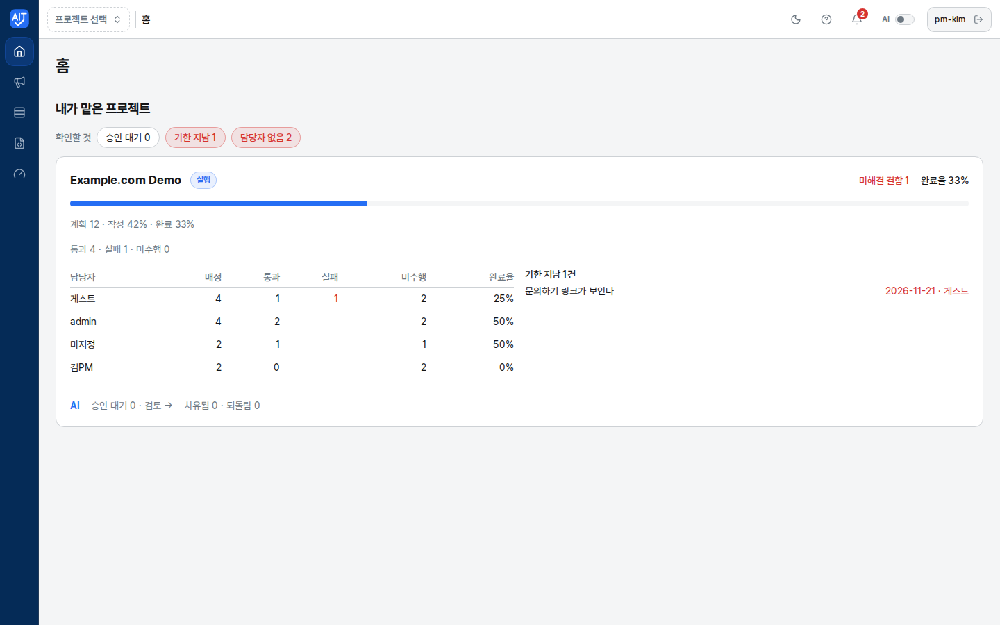
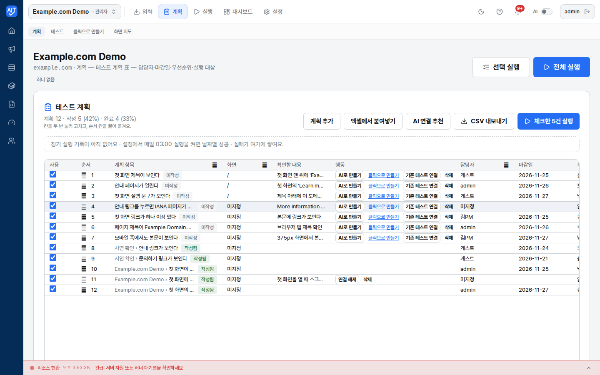
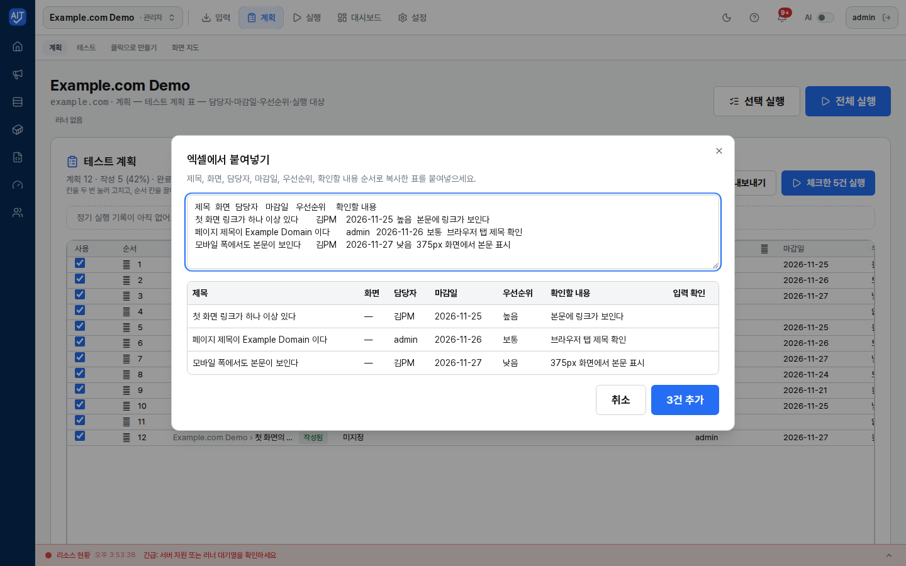
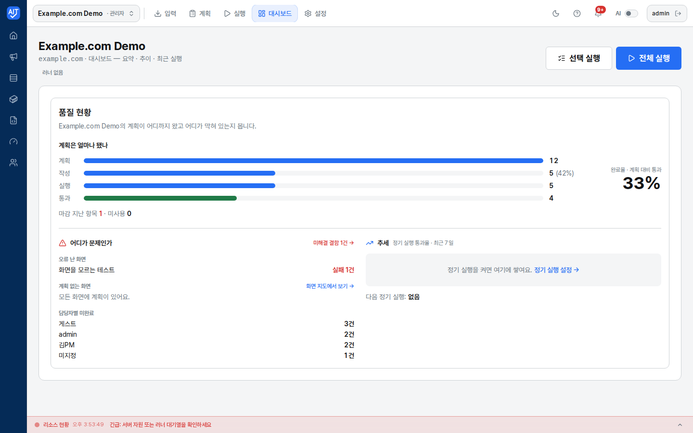
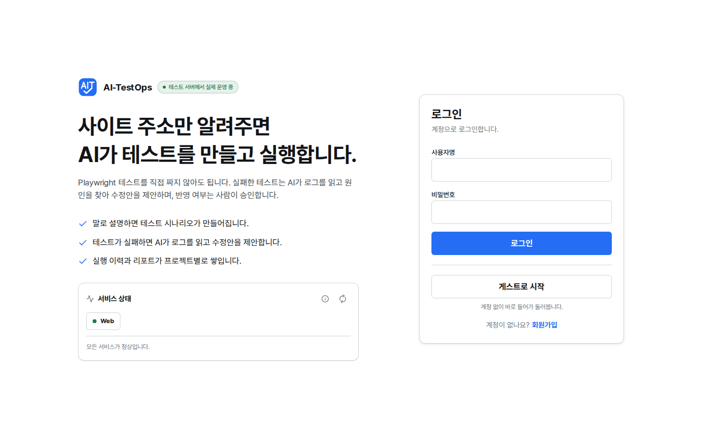
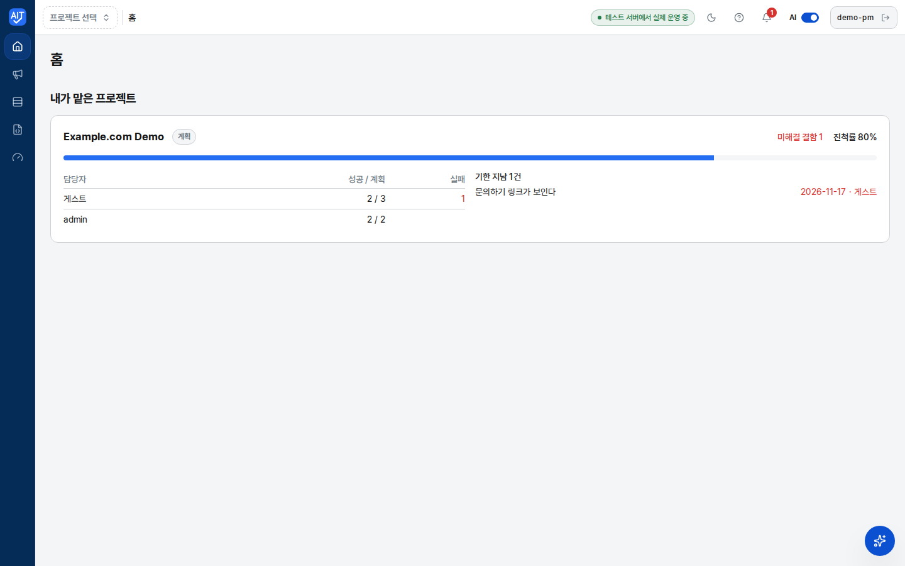
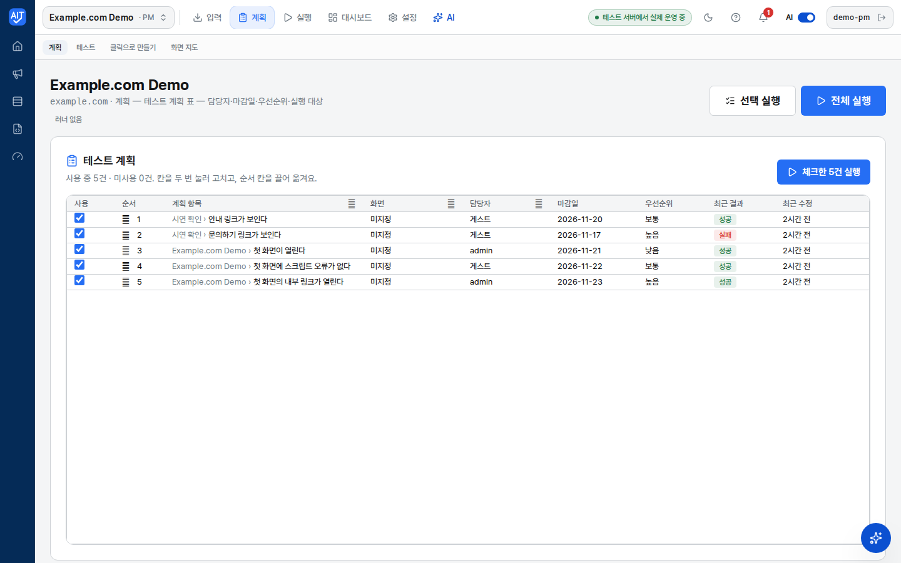
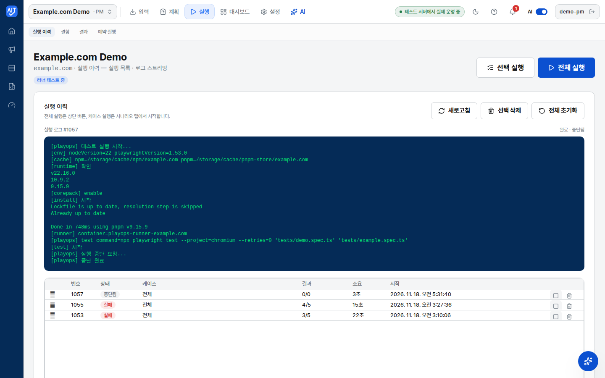

# 11/24 3분 시연 순서 — 계획 우선 흐름

배포 주소(README 맨 위)에서 **시연용 PM 계정 하나로** 처음부터 끝까지 진행한다. 계정 전환은 하지 않는다.
이야기 줄기: **PM이 계획을 세운다 → AI · 사람이 테스트를 잇는다 → 실행 → 결함 → 대시보드에서 계획 대비 완료율을 본다.**

- 화면은 1440px 이상 브라우저 창 하나. 탭은 미리 로그인 화면 하나만 열어 둔다
- 시연 프로젝트: **Example.com Demo** (example.com)
  - 테스트 5건(정상 4 + 일부러 실패하는 "문의하기 링크가 보인다") = 작성됨
  - 미작성 계획 3건(시드): 첫 화면 제목이 보인다 · 안내 페이지가 열린다 · 첫 화면 설명 문구가 보인다
- 되돌린 직후 숫자: 계획 8 · 작성 5 (63%) · 완료 4 (50%) · 미해결 결함 1

## 시연 전 준비 (하루 전 · 10분 전)

| 언제 | 할 일 |
|---|---|
| 하루 전 | 시연 PM 계정 확인 — 아이디 `demo-pm`(서버 `.env`의 `DEMO_PM_USERNAME`), 비밀번호는 **테스트 서버의 `.env`에서만** 확인: `ssh` 후 `grep '^DEMO_PM_' /home/playops/playops/.env`. 문서 · 채팅에 적지 않는다 |
| 하루 전 | **정기 실행 등록**: 설정 › 정기 실행에서 Example.com Demo 를 매일 03:00 으로. 11/23 · 11/24 새벽 결과가 계획 표 날짜 칸 · 대시보드 추세에 실제로 쌓인다 |
| 하루 전 | **AI 확인**: 상단 AI 스위치가 켜지는지, 미작성 행 [AI로 만들기]가 'AI 작성 중'으로 바뀌는지 한 번 눌러 보고 되돌리기. 안 되면 4단계는 [기존 테스트 연결]만 한다 |
| 10분 전 | `./scripts/demo-reset.sh` (아래 [되돌리기](#리허설-뒤-되돌리기)) → 마지막 줄 `되돌림 완료`, "계획 8건 · 미작성 3건" |
| 10분 전 | 붙여넣을 표를 메모장에 열어 두기 (아래 [붙여넣을 표](#붙여넣을-표)) — 시연 때 전체 선택 · 복사만 한다 |
| 10분 전 | 브라우저 창 크기 · 확대 100% · 다크 모드 끔, 알림 · 메신저 끔 |

## 순서 (3분)

| # | 시간 | 화면 · 누를 곳 | 말할 한 줄 | 막히면 |
|---|---|---|---|---|
| 1 | 0:00 | **로그인** (오른쪽 아래 "게스트로 시작"은 가리키기만) → **홈** "내가 맡은 프로젝트" 카드의 **완료율** 막대와 "계획 8 · 작성 63% · 완료 50%" | "PM은 첫 화면에서 계획 대비 얼마나 왔는지부터 봅니다. 테스트 서버에서 실제로 돌고 있습니다." | 로그인 실패 → 서버 `.env` 비밀번호 확인 |
| 2 | 0:15 | 카드 열기 → 상단 **계획** › 계획 표. 회색 **미작성** 3건과 초록 **작성됨** 5건 | "계획이 먼저입니다. 아직 테스트가 없는 항목도 계획으로 먼저 올려 두고, 담당자 · 마감일 · 우선순위를 정합니다." | 표가 비면 새로 고침 |
| 3 | 0:35 | **[엑셀에서 붙여넣기]** → 메모장의 표 붙여넣기 → 미리보기(담당자 · 우선순위가 자동으로 맞춰짐) → **[3건 추가]**. 요약이 "계획 11 · 작성 45% · 완료 36%"로 | "QA가 쓰던 엑셀 TC를 그대로 붙여넣습니다. 계획이 늘었으니 완료율도 정직하게 내려갑니다." | 미리보기에 빨간 표시 → 그 칸만 비워도 추가된다 |
| 4 | 1:00 | ① 방금 넣은 "**첫 화면 링크가 하나 이상 있다**" 행 **[AI로 만들기]** → 배지 **AI 작성 중** ② 시드 "**안내 페이지가 열린다**" 행 **[기존 테스트 연결]** → "시연 확인 › 안내 링크가 보인다" → **[연결]** → 작성됨, 작성률 올라감 | "미작성 항목은 AI가 화면 지도를 보고 테스트를 씁니다. 사람이 승인하면 계획 제목과 같은 테스트가 생겨 자동으로 연결됩니다. 이미 있는 테스트는 골라서 바로 잇습니다." | AI가 꺼져 있으면 ①은 말로만, ②만 한다 |
| 5 | 1:35 | 오른쪽 위 **[체크한 N건 실행]** → 확인 → 진행 표시(스피너 · 남은 시간) | "체크한 계획만 실행합니다. 미작성 항목은 테스트가 없으니 저절로 빠집니다." | "이미 실행 중"이면 그대로 다음으로 |
| 6 | 1:50 | 상단 **실행** › **결함** → "문의하기 링크가 보인다" 클릭 → 단계별 실행 기록의 빨간 단계 · 실패 화면 · 영상 | "실패는 결함 하나로 모이고, 어느 단계에서 왜 실패했는지 한국어 문장과 그 순간의 화면으로 보입니다." | 화면 · 영상은 아래로 조금 스크롤 |
| 7 | 2:20 | 상단 **대시보드** → ① 계획 → 작성 → 실행 → 통과 막대와 **완료율** ② 어디가 문제인가(미해결 결함 · 담당자별 미완료) ③ 추세(정기 실행 통과율) | "대시보드는 세 가지만 답합니다. 계획 대비 얼마나 왔나, 어디가 문제인가, 나아지고 있나. 실행 · 결함 · 대시보드가 모두 계획에 묶여 있습니다." | 추세가 비어 있으면 "매일 03:00 정기 실행이 쌓이면 여기에 보입니다"로 마무리 |
| — | 3:00 | 끝 | | |

시간이 남으면(질문 시간): 결함 체크 → **[실패만 다시 실행]** → 해결로 바뀌는 흐름, 또는 **설정 › 코드 편집기**에서 `demo.spec.ts` 13번째 줄 `문의하기` → `Learn more` 로 고치고 다시 실행(아래 [부록](#부록-결함-고치기-흐름-예전-3분-순서)).

### 붙여넣을 표

메모장에 아래 4줄(머리글 포함, 칸 사이는 **탭**)을 넣어 둔다. 엑셀에서 복사한 것과 같다.

```text
제목	화면	담당자	마감일	우선순위	확인할 내용
첫 화면 링크가 하나 이상 있다		demo-pm	2026-11-25	높음	본문에 링크가 보인다
페이지 제목이 Example Domain 이다		admin	2026-11-26	보통	브라우저 탭 제목 확인
모바일 폭에서도 본문이 보인다		demo-pm	2026-11-27	낮음	375px 화면에서 본문 표시
```

### 화면 (로컬 리허설, 11/22)

| 1 PM 홈 | 2 계획 표 (미작성 · 작성됨) | 3 엑셀에서 붙여넣기 |
|---|---|---|
|  |  |  |

| 6 결함 | 6 실패 단계 · 화면 · 영상 | 7 대시보드 |
|---|---|---|
|  |  |  |

## 리허설 뒤 되돌리기

리허설을 몇 번이든 할 수 있게 **명령 하나**로 원래 상태(실패하는 시연 spec · 미해결 결함 1건)로 돌린다.

```bash
# 테스트 서버에서 (서버 .env 의 시연 PM 계정을 쓴다)
cd /home/playops/playops && ./scripts/demo-reset.sh
```

- 하는 일: 시연 spec(`tests/demo.spec.ts`)을 저장소 원본으로 덮어씀 → 계획 표 되돌리기(시연 중 연결 해제 · 붙여넣은 계획 삭제 · 모두 '사용', 시드 미작성 3건은 남김) → 한 번 실행(돌고 있으면 끝날 때까지 기다림) → **미해결 결함 1건**인지 확인. 아니면 실패로 끝남
- 마지막 줄이 `되돌림 완료`면 끝 (30초 안팎)
- 서버 밖에서는 `BASE_URL=<API 주소> DEMO_PM_PASSWORD=<값> ./scripts/demo-reset.sh` (값은 터미널에만)
- 자동 리허설 `gh workflow run demo-rehearsal.yml`은 끝나면 이 명령을 스스로 돌린다. 단, 자동 리허설이 누르는 순서는 부록(예전 순서)이다 — 새 3분 순서는 사람이 리허설한다
- AI로 만들기는 승인 전이라 파일이 생기지 않는다. 승인까지 했다면 `tests/plan/plan-*.spec.ts` 가 남으므로 코드 편집기에서 지운다

## 알아 둘 것

- 시연 PM 비밀번호를 바꾸려면 서버 `.env`의 `DEMO_PM_PASSWORD`를 고치고 `docker compose -f docker-compose.dev.yml up -d api` (다음 기동에 반영)
- 배포가 돌면 셀프 회귀 테스트 · 시연 프로젝트 확인 실행이 함께 돈다. **시연 직전에는 main 머지를 하지 않는다**
- 시연 중 다른 사람이 같은 프로젝트를 실행하면 "이미 실행 중입니다"가 뜬다 (같은 프로젝트 동시 실행은 서버가 막음)

## 부록: 결함 고치기 흐름 (예전 3분 순서)

질문 시간이나 시간이 남을 때. 아래는 11/18 리허설 기준 순서다.

| # | 화면 · 누를 곳 | 말할 한 줄 | 막히면 |
|---|---|---|---|
| 1 | **로그인 화면** — 오른쪽 아래 "게스트로 시작" 버튼을 손으로 가리키기만. 아이디 · 비밀번호 입력 후 "로그인" | "가입 없이 게스트로도 둘러볼 수 있고, 오늘은 PM 계정으로 보여 드립니다. 왼쪽 위 초록 표시처럼 실제 테스트 서버에서 돌고 있습니다." | 로그인 실패 → 비밀번호를 서버 `.env`에서 다시 확인. 화면이 안 뜨면 README 주소가 바뀌었는지(터널 재시작) 확인 |
| 2 | **첫 화면(홈)** — "내가 맡은 프로젝트"의 Example.com Demo 진척률 · 담당자별 진행 · 기한 지남. 왼쪽 레일 **프로젝트 목록** → 카드의 진척률 | "역할마다 첫 화면이 다릅니다. PM은 진척률과 기한이 지난 항목을 먼저 봅니다." | 숫자가 0이면 시연 데이터가 안 채워진 것 → 되돌리기 실행 |
| 3 | 카드 **열기** → 상단 **계획** › 계획 표 | "테스트 하나가 계획 항목 하나입니다. 담당자 · 마감일 · 우선순위를 엑셀처럼 정하고, 왼쪽 '사용' 체크로 이번에 돌릴 것을 고릅니다." | 표가 비어 있으면 새로 고침 |
| 4 | 오른쪽 위 **전체 실행** → 확인 창 "확인" → 실행 이력에서 로그가 흐르는 것 → **실행 중지** → 확인 | "실행하면 로그가 실시간으로 흐르고, 잘못 눌렀으면 바로 멈출 수 있습니다." | 실행이 너무 빨리 끝나 "실행 중지"를 못 눌렀으면 그대로 다음으로. "이미 실행 중입니다"가 뜨면 앞 실행이 끝나길 10초 기다림 |
| 5 | 상단 하위 탭 **결함** | "실패는 실행마다 흩어지지 않고 결함 하나로 모입니다. 처음 발견된 실행, 실패 횟수, 실행 흐름이 한 줄에 보입니다." | 미해결이 0이면 되돌리기를 안 한 것 → 이 단계는 말로만 넘어가고 끝나고 되돌리기 |
| 6 | 결함의 케이스 이름 **"문의하기 링크가 보인다"** 클릭 → 결과 탭 "단계별 실행 기록"이 펼쳐지고 빨간 2번째 단계 · 실패 시점 화면 · 영상(▶) | "어느 단계에서 왜 실패했는지 코드 없이 한국어로 보입니다. 실패한 그 순간의 화면과, 실패 2초 전부터의 영상입니다. 사이트에 '문의하기' 링크가 없어서 실패했네요." | 화면 · 영상이 안 보이면 아래로 조금 스크롤. 영상은 ▶을 눌러야 재생 |
| 7 | 상단 **설정** › 하위 탭 **코드 편집기** → 왼쪽 파일 탐색기 **tests** › **demo.spec.ts** → **13번째 줄** `name: '문의하기'`의 `문의하기`를 **더블클릭** → `Learn more` 입력 → 오른쪽 위 **저장** | "실제 사이트의 링크 이름은 'Learn more'라서 테스트를 고칩니다. PM은 여기서 바로 고칠 수 있습니다." | 자동완성 창이 뜨면 **Esc**로 닫고 줄이 `name: 'Learn more'`인지 확인. 따옴표가 지워졌으면 **취소**로 되돌려 다시 |
| 8 | 상단 **실행** › **결함** → 케이스 왼쪽 체크 → **고른 1건 다시 실행** → 확인 | "고친 결함만 골라 다시 돌립니다. 새 실행은 실패했던 실행에 이어집니다." | "이미 실행 중입니다"면 4번 실행이 남은 것 → 10초 뒤 다시 |
| 9 | 10 ~ 20초 뒤 **결함** 탭 → 상태 필터 **상태: 전체** → "해결" 표시 · 실행 흐름 `#… 발견 → … → #… 해결 · 다시` | "다시 실행이 통과해 결함이 해결로 바뀌었습니다. 발견부터 해결까지의 흐름이 남습니다." | 아직 미해결이면 실행 이력에서 끝났는지 확인 후 다시 결함 탭. 실패로 끝났으면 7번 저장을 안 한 것 |

### 화면

| 1 로그인 | 2 첫 화면 | 2 프로젝트 카드 |
|---|---|---|
|  |  |  |

| 3 계획 표 | 4 실행 중 | 4 중지 |
|---|---|---|
|  |  |  |

| 5 결함 | 6 실패 단계 · 화면 · 영상 | 7 코드 편집기 (13번째 줄) |
|---|---|---|
|  |  |  |

| 8 다시 실행 | 9 해결 |
|---|---|
|  |  |

