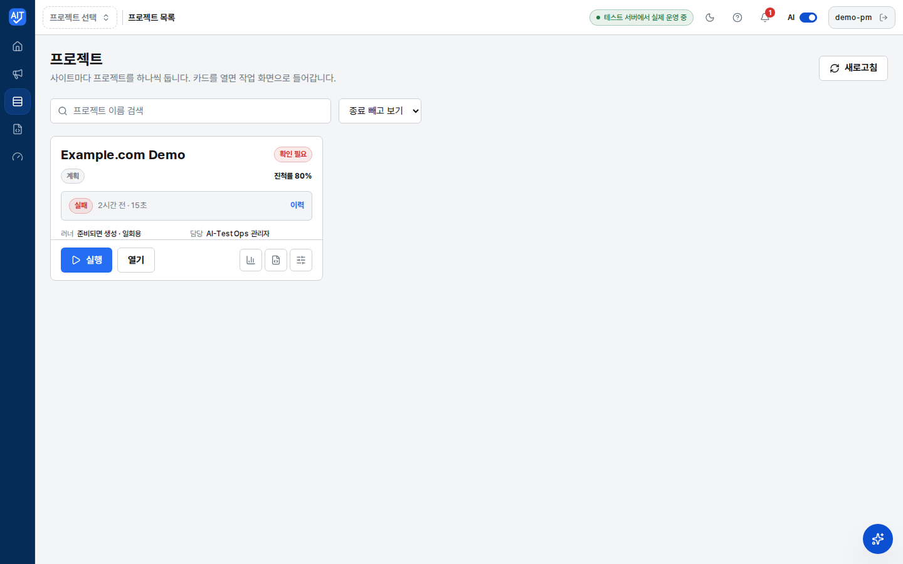
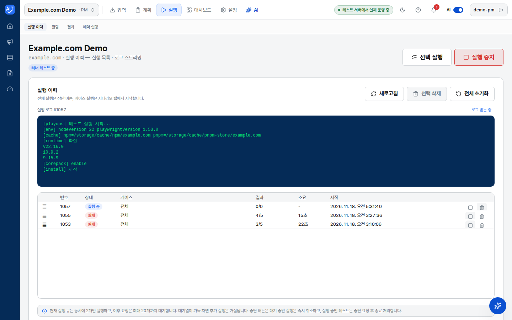
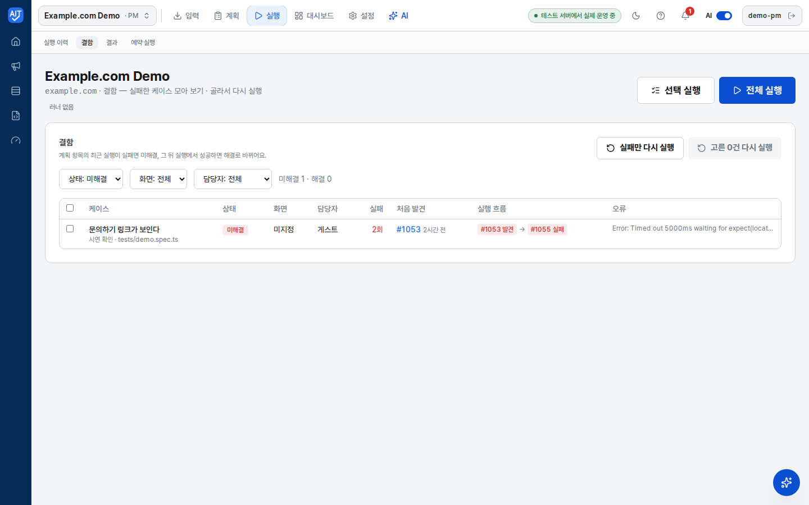
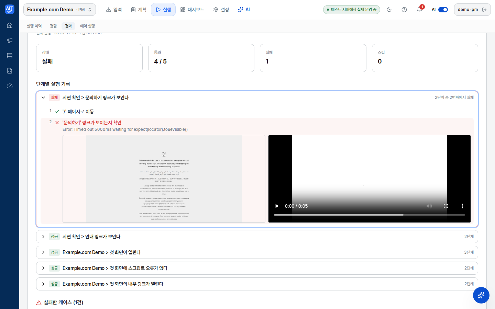
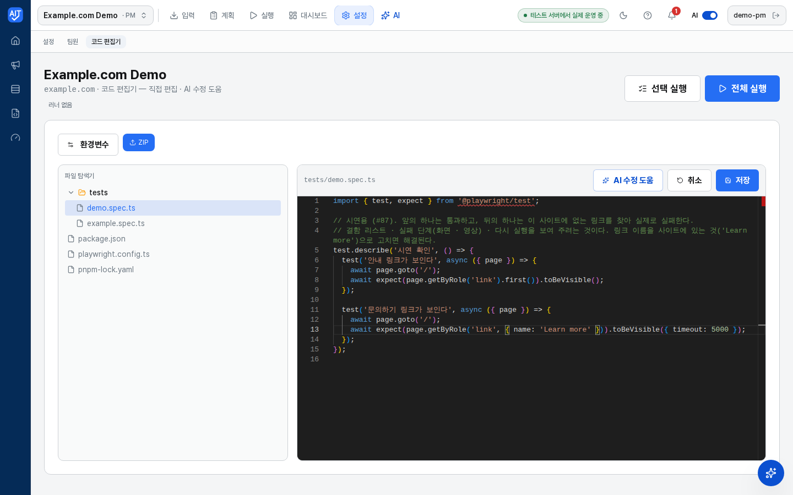
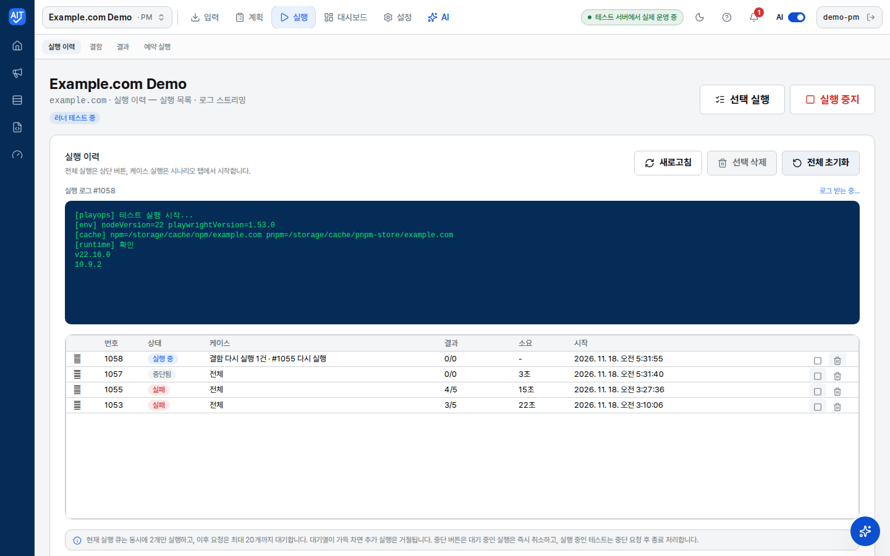
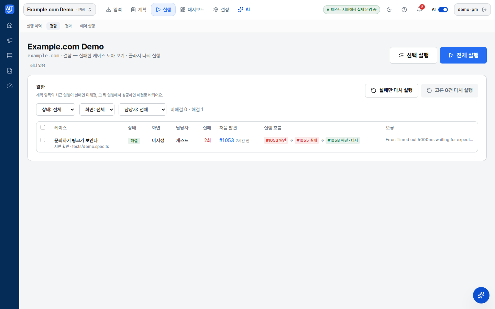

# 11/24 3분 시연 순서

배포 주소(README 맨 위)에서 **시연용 PM 계정 하나로** 처음부터 끝까지 진행한다. 계정 전환은 하지 않는다.
게스트 입장은 로그인 화면에 버튼이 있다는 것만 보여 준다.

- 화면은 1440px 이상 브라우저 창 하나. 탭은 미리 로그인 화면 하나만 열어 둔다
- 시연 프로젝트: **Example.com Demo** (example.com) — 정상 4건 + 일부러 실패하는 1건("문의하기 링크가 보인다")
- 아래 화면은 배포 서버 리허설(`demo-rehearsal.yml`)이 이 순서를 그대로 눌러 남긴 것이다

## 시연 전 준비 (하루 전 · 10분 전)

| 언제 | 할 일 |
|---|---|
| 하루 전 | 시연 PM 계정 확인 — 아이디 `demo-pm`(서버 `.env`의 `DEMO_PM_USERNAME`), 비밀번호는 **테스트 서버의 `.env`에서만** 확인: `ssh` 후 `grep '^DEMO_PM_' /home/playops/playops/.env`. 문서 · 채팅에 적지 않는다 |
| 하루 전 | 리허설 한 번: `gh workflow run demo-rehearsal.yml` → Actions에서 초록이면 끝까지 동작 · 원래 상태로 되돌려진 것 |
| 10분 전 | 원래 상태 확인: 결함 탭 **미해결 1** ("문의하기 링크가 보인다"). 아니면 [되돌리기](#리허설-뒤-되돌리기) |
| 10분 전 | 브라우저 창 크기 · 확대 100% · 다크 모드 끔, 알림 · 메신저 끔 |

## 순서 (3분)

| # | 화면 · 누를 곳 | 말할 한 줄 | 막히면 |
|---|---|---|---|
| 1 | **로그인 화면** — 오른쪽 아래 "게스트로 시작" 버튼을 손으로 가리키기만. 아이디 · 비밀번호 입력 후 "로그인" | "가입 없이 게스트로도 둘러볼 수 있고, 오늘은 PM 계정으로 보여 드립니다. 왼쪽 위 초록 표시처럼 실제 테스트 서버에서 돌고 있습니다." | 로그인 실패 → 비밀번호를 서버 `.env`에서 다시 확인. 화면이 안 뜨면 README 주소가 바뀌었는지(터널 재시작) 확인 |
| 2 | **첫 화면(홈)** — "내가 맡은 프로젝트"의 Example.com Demo 진척률 · 담당자별 진행 · 기한 지남. 왼쪽 레일 **프로젝트 목록** → 카드의 진척률 | "역할마다 첫 화면이 다릅니다. PM은 진척률과 기한이 지난 항목을 먼저 봅니다." | 숫자가 0이면 시연 데이터가 안 채워진 것 → 되돌리기 실행 |
| 3 | 카드 **열기** → 상단 **계획** › 계획 표 | "테스트 하나가 계획 항목 하나입니다. 담당자 · 마감일 · 우선순위를 엑셀처럼 정하고, 왼쪽 '사용' 체크로 이번에 돌릴 것을 고릅니다." | 표가 비어 있으면 새로 고침 |
| 4 | 오른쪽 위 **전체 실행** → 확인 창 "확인" → 실행 이력에서 로그가 흐르는 것 → **실행 중지** → 확인 | "실행하면 로그가 실시간으로 흐르고, 잘못 눌렀으면 바로 멈출 수 있습니다." | 실행이 너무 빨리 끝나 "실행 중지"를 못 눌렀으면 그대로 다음으로. "이미 실행 중입니다"가 뜨면 앞 실행이 끝나길 10초 기다림 |
| 5 | 상단 하위 탭 **결함** | "실패는 실행마다 흩어지지 않고 결함 하나로 모입니다. 처음 발견된 실행, 실패 횟수, 실행 흐름이 한 줄에 보입니다." | 미해결이 0이면 되돌리기를 안 한 것 → 이 단계는 말로만 넘어가고 끝나고 되돌리기 |
| 6 | 결함의 케이스 이름 **"문의하기 링크가 보인다"** 클릭 → 결과 탭 "단계별 실행 기록"이 펼쳐지고 빨간 2번째 단계 · 실패 시점 화면 · 영상(▶) | "어느 단계에서 왜 실패했는지 코드 없이 한국어로 보입니다. 실패한 그 순간의 화면과, 실패 2초 전부터의 영상입니다. 사이트에 '문의하기' 링크가 없어서 실패했네요." | 화면 · 영상이 안 보이면 아래로 조금 스크롤. 영상은 ▶을 눌러야 재생 |
| 7 | 상단 **설정** › 하위 탭 **코드 편집기** → 왼쪽 파일 탐색기 **tests** › **demo.spec.ts** → **13번째 줄** `name: '문의하기'`의 `문의하기`를 **더블클릭** → `Learn more` 입력 → 오른쪽 위 **저장** | "실제 사이트의 링크 이름은 'Learn more'라서 테스트를 고칩니다. PM은 여기서 바로 고칠 수 있습니다." | 자동완성 창이 뜨면 **Esc**로 닫고 줄이 `name: 'Learn more'`인지 확인. 따옴표가 지워졌으면 **취소**로 되돌려 다시 |
| 8 | 상단 **실행** › **결함** → 케이스 왼쪽 체크 → **고른 1건 다시 실행** → 확인 | "고친 결함만 골라 다시 돌립니다. 새 실행은 실패했던 실행에 이어집니다." | "이미 실행 중입니다"면 4번 실행이 남은 것 → 10초 뒤 다시 |
| 9 | 10 ~ 20초 뒤 **결함** 탭 → 상태 필터 **상태: 전체** → "해결" 표시 · 실행 흐름 `#… 발견 → … → #… 해결 · 다시` | "다시 실행이 통과해 결함이 해결로 바뀌었습니다. 발견부터 해결까지의 흐름이 남습니다." | 아직 미해결이면 실행 이력에서 끝났는지 확인 후 다시 결함 탭. 실패로 끝났으면 7번 저장을 안 한 것 |

### 화면

| 1 로그인 | 2 첫 화면 | 2 프로젝트 카드 |
|---|---|---|
|  |  |  |

| 3 계획 표 | 4 실행 중 | 4 중지 |
|---|---|---|
|  |  |  |

| 5 결함 | 6 실패 단계 · 화면 · 영상 | 7 코드 편집기 (13번째 줄) |
|---|---|---|
|  |  |  |

| 8 다시 실행 | 9 해결 |
|---|---|
|  |  |

## 리허설 뒤 되돌리기

리허설을 몇 번이든 할 수 있게 **명령 하나**로 원래 상태(실패하는 시연 spec · 미해결 결함 1건)로 돌린다.

```bash
# 테스트 서버에서 (서버 .env 의 시연 PM 계정을 쓴다)
cd /home/playops/playops && ./scripts/demo-reset.sh
```

- 하는 일: 시연 spec(`tests/demo.spec.ts`)을 저장소 원본으로 덮어씀 → 계획 표 모두 '사용' → 한 번 실행(돌고 있으면 끝날 때까지 기다림) → **미해결 결함 1건**인지 확인. 아니면 실패로 끝남
- 마지막 줄이 `되돌림 완료`면 끝 (30초 안팎)
- 서버 밖에서는 `BASE_URL=<API 주소> DEMO_PM_PASSWORD=<값> ./scripts/demo-reset.sh` (값은 터미널에만)
- 자동 리허설 `gh workflow run demo-rehearsal.yml`은 끝나면 이 명령을 스스로 돌린다

## 알아 둘 것

- 시연 PM 비밀번호를 바꾸려면 서버 `.env`의 `DEMO_PM_PASSWORD`를 고치고 `docker compose -f docker-compose.dev.yml up -d api` (다음 기동에 반영)
- 배포가 돌면 셀프 회귀 테스트 · 시연 프로젝트 확인 실행이 함께 돈다. **시연 직전에는 main 머지를 하지 않는다**
- 시연 중 다른 사람이 같은 프로젝트를 실행하면 "이미 실행 중입니다"가 뜬다 (같은 프로젝트 동시 실행은 서버가 막음)
