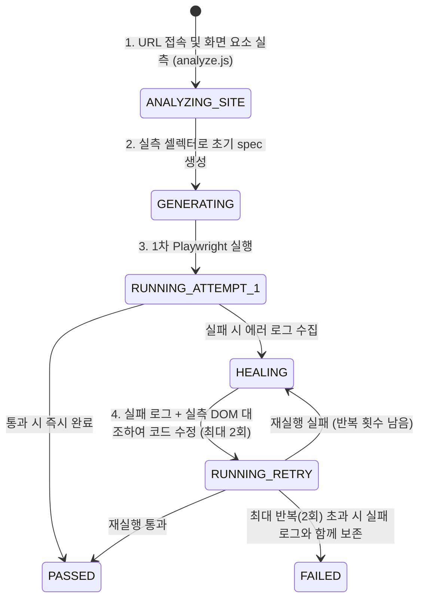

# URL 기반 E2E 테스트 코드 자동 작성 설계서 (Lv2 사이트 탐색 + Lv3 자율 검증 루프)

> **문서 목적**
> 앱 소스 코드 저장소(`sourceRepositoryUrl`) 없이 **대상 사이트 주소(`baseUrl`)와 자연어 요구사항만으로 실행 가능한 고품질 Playwright E2E 테스트 코드를 생성·검증·자가 교정**하기 위한 상세 기술 설계서이다.

---

## 1. 배경 및 현황 진단 (As-Is 분석)

### 1.1 왜 현재 URL 기반 테스트 생성이 부정확한가?
현재 프로젝트 등록 직후 실행되는 **첫 테스트(`AiBootstrapService` → `AiTemplateService`)**는 UI 설명(*"AI가 이 사이트를 열어보고 맞는 테스트 케이스를 만든다"*)과 달리 실제로는 사이트를 열어보지 않는다.

1. **화면 정보 없는 Blind Prompting**: [`AiTemplateService.java`](../apps/api/src/main/java/com/playops/api/service/AiTemplateService.java)는 LLM에 `Target Web URL`, `Template Name`, `User Requirements` **문자열 3개만** 전달한다.
2. **셀렉터 환각(Hallucination) 또는 무의미한 코드**: 실제 DOM 구조를 모르기 때문에 LLM은：① `await expect(page).toHaveTitle(/./)` 같은 껍데기 검증만 생성하거나, ② 실제 화면에 없는 `getByRole('button', { name: '로그인' })` 등을 추측하여 생성 직후 첫 실행에서 `FAILED`가 발생한다.
3. **실패 후 자가 교정 부재**: 첫 실행이 실패해도 에러 로그를 보고 셀렉터를 고치는 루프 없이 즉시 실패로 종료된다.

### 1.2 코드베이스 내 미연결 핵심 자산 발견 (`apps/api/ai-runner/analyze.js`)
저장소 조사 결과, [`apps/api/ai-runner/analyze.js`](../apps/api/ai-runner/analyze.js) 및 [`apps/api/ai-runner/README.md`](../apps/api/ai-runner/README.md)에 이미 **`SITE_ANALYSIS` (대상 사이트 DOM 탐색 및 실시간 셀렉터 검증 엔진)**가 구현되어 있으나, **Spring Boot 백엔드(`apps/api`)와 전혀 연결되어 있지 않은 상태**임이 확인되었다.

| 구분 | 구현 위치 | 현재 상태 | 핵심 기능 |
| :--- | :--- | :---: | :--- |
| **브라우저 기반 사이트 탐색기** | [`apps/api/ai-runner/analyze.js`](../apps/api/ai-runner/analyze.js)<br>(`jobType: "SITE_ANALYSIS"`) | **스크립트 구현 완료**<br>*(백엔드 미연결)* | - Chromium으로 `baseUrl` 접속 및 SPA 네트워크·DOM 안정화 대기(`waitSettled`)<br>- 가시적 상호작용 요소(`a`, `button`, `input`, `select`, `role` 등) 및 `form` 구조 수집<br>- 후보 셀렉터를 **실제 페이지에 실행(`loc.count() === 1`)하여 단일 매칭 검증(`resolveSelector`)**<br>- 페이지별 `ariaSnapshot` 및 스크린샷(`screens/*.jpg`) 저장, 동일 호스트 링크 BFS 탐색 |
| **실패 수정 루프** | [`apps/api/ai-runner/run.js`](../apps/api/ai-runner/run.js)<br>(`jobType: "CODE_FIX"`) | **구현 완료**<br>*(수동 요청 시에만 동작)* | - 컨테이너 내부에서 `npx playwright test` 실행 후 실패 로그를 받아 LLM으로 수정·재실행 반복 |
| **프롬프트 주입 및 셀렉터 대조** | [`SiteMapPromptService.java`](../apps/api/src/main/java/com/playops/api/service/SiteMapPromptService.java) | **`CODE` 출처만 연동** | - `site_node` 테이블의 화면·요소·셀렉터 정보를 프롬프트로 포맷팅하고, 생성된 spec이 미등록 셀렉터를 썼는지 검증(`check()`) |

> **핵심 결론**: 밑바닥부터 새로 개발할 필요 없이, 이미 구현된 **`analyze.js`(`SITE_ANALYSIS` = Lv2)** + **`SiteMapPromptService`(프롬프트 주입)** + **`run.js`(실행 검증 및 자율 수정 = Lv3)** 세 모듈을 백엔드 파이프라인으로 연결하면 가장 이상적인 URL 기반 E2E 생성 아키텍처가 완성된다.

---

## 2. 목표 아키텍처 (To-Be: Observe → Generate → Verify & Heal)

URL 기반 E2E 코드 작성은 **3단계 파이프라인(관찰 → 생성 → 검증 및 자율 수정)**으로 동작한다.

```mermaid
flowchart TB
    User(["👤 사용자 (URL + 테스트 요구사항 입력)"])

    subgraph Step1["Phase 1: 사이트 관찰 및 셀렉터 실측 검증 (Lv2 - Observe)"]
        CheckDB{"기존 분석된 화면\n(site_node) 존재?"}
        RunAnalyze["🐳 AI Runner (SITE_ANALYSIS)\nanalyze.js 실행 (LLM 비용 0)"]
        VerifyLoc["Playwright 실시간 검증\n- waitSettled (SPA 렌더링 대기)\n- 후보 로케이터 count()===1 확인\n- forms / ariaSnapshot 추출"]
        SaveDB[("🗄️ DB 적재\nsite_node (origin='SITE')\nsite_edge")]
    end

    subgraph Step2["Phase 2: 실측 셀렉터 기반 코드 생성 (Generate)"]
        BuildPrompt["SiteMapPromptService\n검증된 셀렉터 + 폼 구조 + ariaSnapshot\n프롬프트 조립"]
        CallLLM["🤖 LLMGatewayService\n초기 spec 코드(.spec.ts) 생성\n(임의 셀렉터 생성 금지 강제)"]
        CheckHallucination["SiteMapPromptService.check()\n미등록 셀렉터 사용 여부 사전 검사"]
    end

    subgraph Step3["Phase 3: 실행 검증 및 자율 교정 루프 (Lv3 - Verify & Heal)"]
        FirstRun["🐳 1차 Playwright 실행\n(npx playwright test)"]
        IsPassed{"통과 여부\n(PASSED?)"}
        HealLoop["🔧 자율 수정 루프 (최대 2회)\n실패 로그 + 수집된 화면 DOM/ariaSnapshot 대조\n셀렉터·대기조건·네비게이션 수정 후 재실행"]
        FinalSave["✅ 최종 spec 확정 및 실행 리포트 반환"]
    end

    User --> CheckDB
    CheckDB -->|없음 / 첫 테스트| RunAnalyze
    RunAnalyze --> VerifyLoc --> SaveDB --> BuildPrompt
    CheckDB -->|있음 (CODE 또는 SITE)| BuildPrompt
    BuildPrompt --> CallLLM --> CheckHallucination --> FirstRun
    FirstRun --> IsPassed
    IsPassed -->|Yes (1차 통과)| FinalSave
    IsPassed -->|No (실패)| HealLoop
    HealLoop --> FirstRun
```

---

## 3. 단계별 상세 기술 설계

### 3.1 [Phase 1] 브라우저 기반 사이트 관찰 (`Lv2: SITE_ANALYSIS`)

#### (1) 동작 원리 ([`apps/api/ai-runner/analyze.js`](../apps/api/ai-runner/analyze.js) 활용)
1. **SPA 렌더링 완료 대기 (`waitSettled`)**
   - 단순 `domcontentloaded` 직후 DOM을 읽으면 React/Vue/Next.js 등 SPA에서는 빈 `<div id="root"></div>`만 수집된다.
   - `trackRequests(page)`와 `MutationObserver`(`__aitLastMutation`)를 결합하여 **진행 중인 `fetch/xhr` 요청이 0개이고 DOM 변경이 `600ms` 이상 멈출 때까지(최대 10초)** 기다린 후 요소를 수집한다.
2. **상호작용 요소 수집 및 실시간 셀렉터 검증 (`resolveSelector`)**
   - 화면에 실제로 보이는(`getBoundingClientRect().width > 0`, `visibility !== 'hidden'`) 요소마다 임시 속성 `data-ait-idx`를 부여한다.
   - 아래 우선순위대로 Playwright Locator 후보를 생성한 뒤, **실제 브라우저 페이지에서 `await loc.count() === 1`이고 가리키는 요소의 `data-ait-idx`가 일치하는 첫 번째 후보만 채택**한다:
     1. `getByTestId('...')` (`testid`)
     2. `getByRole('...', { name: '...', exact: true })` (`role`)
     3. `getByLabel('...', { exact: true })` (`label`)
     4. `getByPlaceholder('...', { exact: true })` (`placeholder`)
     5. `getByText('...', { exact: true })` (`text` — `a`, `button` 한정)
     6. 영역 범위 좁히기: `getByRole('<landmark>').getByRole('...', { name: '...' })` (`scoped` — `nav`, `header`, `main`, `dialog`, `form` 등)
     7. 정적 ID: `locator('#id')` (`css` — 해시/숫자 자동생성 ID 제외)
     8. 최후 수단: `getByRole(...).nth(k)` (`nth` — `fragile: true` 표시)
3. **안전한 다중 페이지 탐색 (Safe BFS)**
   - 클릭이나 폼 제출 없이 `<a href>` 링크만 따라가며 동일 호스트 내에서 탐색한다(`logout`, `delete`, `remove`, `로그아웃` 포함 URL 자동 제외).
   - **빠른 첫 테스트 모드(`quickBootstrap`)**: 등록 직후 첫 테스트 생성 시에는 대기 시간을 줄이기 위해 `limits: { maxPages: 5, maxDepth: 1, timeoutMs: 45000 }`으로 경량 탐색을 수행하고, 전체 구조 분석 시에는 기본 상한(`maxPages: 20, maxDepth: 3`)으로 수행한다.

#### (2) DB 저장 매핑 (`analyze.js` 결과 → `site_node` / `site_edge`)
`SiteAnalysisService`에 `runUrlAnalysis(String projectId, boolean quickMode)`를 추가하여 `analyze.js`가 산출한 `result.json`을 기존 DB 테이블에 그대로 적재한다.

| `analyze.js` 출력 (`result.json`) | DB 테이블 · 컬럼 | 매핑 및 병합 규칙 |
| :--- | :--- | :--- |
| `nodes[].path` | `site_node.route_key` | 정규화된 경로 (예: `/`, `/login`, `/products`) |
| `nodes[].title` | `site_node.title` | `<title>` 텍스트 |
| `"SITE"` | `site_node.origin` | 코드 분석(`CODE`)과 구분하여 `SITE`로 기록 |
| `nodes[].elements[]` | `site_node.elements` | `selector != null`인 검증된 요소들을 기존 JSON 스키마(`key`, `kind`, `label`, `selector`, `selectorKind`, `ambiguous: fragile`, `verification: "PASSED"`)로 변환하여 저장 |
| `nodes[].ariaSnapshot` | `site_node.aria_snapshot` *(확장)* 또는 프롬프트 컨텍스트 | 화면의 계층적 구조(제목, 텍스트, 폼 그룹 관계)를 LLM이 이해하도록 보조 정보로 활용 |
| `edges[]` | `site_edge` | `from_route_key`, `to_route_key`, `kind: "LINK"`, `label`, `selector` 저장 |

> **💡 하이브리드 시너지 (`CODE` + `SITE`)**
> 앱 소스 저장소(`CODE`)가 연결된 프로젝트라도, 코드 정적 분석으로 찾은 라우트 목록(`site_node.route_key`)을 `analyze.js`의 `seedUrls`로 넘겨주면, 링크(`<a>`) 없이 버튼 `onClick`으로만 이동하는 숨은 SPA 화면까지 브라우저가 직접 열어서 셀렉터를 실측 검증할 수 있다.

---

### 3.2 [Phase 2] 실측 데이터 기반 E2E 코드 생성 (`Generate`)

LLM이 테스트 코드를 작성할 때 추측을 원천 차단하도록 프롬프트 계약을 아래와 같이 구성한다.

#### (1) 프롬프트 입력 구조 (`SiteMapPromptService` 확장)
```text
[프로젝트 기본 정보]
- 프로젝트명: 쇼핑몰 결제 테스트
- Base URL: https://shop.example.com
- 사용자 테스트 요구사항: 메인 페이지에서 로그인 페이지로 이동해 이메일과 비밀번호 입력창이 보이는지 확인해줘.

[실측 확인된 화면 및 로케이터 목록 (Playwright 검증 완료)]
화면 / (홈 — 쇼핑몰)
  이동 가능 링크:
    - '로그인' -> /login : page.getByRole('link', { name: '로그인', exact: true })
  상호작용 요소:
    - [searchbox] '상품 검색' : page.getByPlaceholder('상품을 검색하세요', { exact: true })
    - [button] '검색' : page.getByRole('button', { name: '검색', exact: true })
  주요 화면 텍스트 요약 (ariaSnapshot):
    - heading "이번 주 베스트셀러" [level=2]

화면 /login (로그인)
  폼(Form #0) 구성:
    - [textbox] '이메일' (required) : page.getByLabel('이메일', { exact: true })
    - [textbox] '비밀번호' (required) : page.getByLabel('비밀번호', { exact: true })
    - [button] '로그인하기' (submit) : page.getByRole('button', { name: '로그인하기', exact: true })
```

#### (2) 시스템 프롬프트 강제 규칙 (Anti-Hallucination Rules)
1. **셀렉터 제한**: 페이지의 요소를 클릭·입력·검증할 때는 반드시 `[실측 확인된 화면 및 로케이터 목록]`에 제공된 로케이터만 그대로(`page.` 접두사) 사용해야 하며, 목록에 없는 CSS 셀렉터나 텍스트를 임의로 지어내지 않는다.
2. **네비게이션 규칙**: 화면 간 이동은 목록에 제공된 전환 링크 로케이터를 클릭하거나 확인된 `route_key` 경로로 `page.goto()`를 호출한다.
3. **불안정(`fragile`) 셀렉터 처리**: `fragile` 또는 `duplicate`로 표시된 로케이터는 `.first()`로 범위를 좁히거나 상위 랜드마크(`scope`) 로케이터를 체이닝한다.
4. **사전 검증(`SiteMapPromptService.check`)**: LLM이 반환한 코드에서 사용된 로케이터를 정규식으로 추출해 수집된 셀렉터 목록과 대조하고, 목록 밖 셀렉터가 발견되면 `riskFlags`에 기록한다.

---

### 3.3 [Phase 3] 실행 및 자율 교정 루프 (`Lv3: Verify & Self-Heal`)

셀렉터가 정확하더라도 실제 실행 시에는 **클릭 후 페이지 전환 대기, 토스트/모달 닫기, 네트워크 응답 지연, Strict Mode 위반** 등으로 인해 1차 실행이 실패할 수 있다. 이를 해결하기 위해 **생성 직후 실행 검증과 최대 2회의 자율 수정 루프**를 결합한다.



#### 자율 수정 루프(`HEALING`) 프롬프트에 전달되는 4대 정보:
1. **방금 실패한 `.spec.ts` 코드 전문**
2. **Playwright 실행 에러 로그 및 Call Log** (예: `locator.click: Error: strict mode violation: getByRole('button') resolved to 2 elements` 또는 `Timed out 5000ms waiting for expect(locator).toBeVisible()`)
3. **Phase 1에서 수집한 해당 화면의 실측 셀렉터 목록 및 `ariaSnapshot`** (대체 가능한 정확한 셀렉터를 바로 찾을 수 있도록 제공)
4. **수정 지침**: *"실패 원인이 잘못된 셀렉터라면 실측 화면 목록의 다른 로케이터로 교체하고, 타이밍/네비게이션 문제라면 `waitForURL` 또는 적절한 assertion 대기로 교정하라."*

---

## 4. 백엔드·프론트엔드 모듈 변경 설계

### 4.1 백엔드 (`apps/api`) 변경 대상

| 클래스명 | 구분 | 주요 추가/변경 내용 |
| :--- | :---: | :--- |
| **`AiRunnerDockerService.java`** | 수정 | - `runSiteAnalysisJob(String projectId, String baseUrl, List<String> seedUrls, boolean quickMode)` 메서드 추가<br>- `job.json`에 `"jobType": "SITE_ANALYSIS"`를 기록하고 `playops-ai-runner:latest`(`analyze.js`) 실행 후 `result.json` 반환 |
| **`SiteAnalysisService.java`** | 수정 | - 앱 소스 저장소(`sourceRepositoryUrl`)가 없을 때도 `baseUrl`이 있으면 `SITE_ANALYSIS` 러너를 통해 화면(`site_node`, `origin='SITE'`)과 전환(`site_edge`)을 저장하는 `analyzeByUrl()` 경로 추가<br>- 소스 저장소가 있는 경우에도 정적 분석된 `route_key`들을 `seedUrls`로 넘겨 실측 보강 가능 |
| **`SiteMapPromptService.java`** | 수정 | - `site_node`에서 `origin='SITE'`인 노드의 `forms` 정보와 `ariaSnapshot` 요약본까지 프롬프트 컨텍스트에 포함하도록 `describe()` 확장 |
| **`AiBootstrapService.java`** | 전면 개편 | - 기존의 단순 `AiTemplateService` 호출 제거<br>- **Step 1**: 프로젝트에 분석된 `site_node`가 없으면 `SiteAnalysisService.analyzeByUrl(projectId, true)`(빠른 탐색) 먼저 수행<br>- **Step 2**: `SiteMapPromptService.context()`가 포함된 프롬프트로 초기 `tests/bootstrap.spec.ts` 생성 및 저장<br>- **Step 3**: `triggerRun()` 실행 후 실패 시 최대 2회 자율 수정(`healBootstrapSpec`) 재시도 연결 |
| **`AiJobService.java`** | 수정 | - 시나리오 탭 / 구조 탭 / 채팅에서 `TEMPLATE_GENERATE` 요청 시, 코드 분석 결과가 없으면 자동으로 `SITE` 분석 컨텍스트를 사용하도록 통합 |

### 4.2 프론트엔드 (`apps/web`) 변경 대상

| 컴포넌트 파일 | 구분 | 주요 변경 내용 |
| :--- | :---: | :--- |
| **`AiBootstrapProgressDialog.tsx`** | 수정 | 진행 단계(`Phase`)를 기존 2단계(`GENERATING` → `RUNNING`)에서 실제 동작에 맞춰 4단계로 세분화하여 사용자에게 투명하게 표시:<br>1. `ANALYZING_SITE`: *"사이트에 접속해 화면 요소와 버튼을 파악하는 중"*<br>2. `GENERATING`: *"파악한 화면 요소로 맞춤형 테스트 코드 작성 중"*<br>3. `RUNNING`: *"생성된 테스트 실행 검증 중"*<br>4. `HEALING` *(1차 실패 시)*: *"실행 로그를 바탕으로 셀렉터를 자동 교정하여 재시도 중 (1/2)"* |
| **`StructureTab.tsx`** | 수정 | - 앱 소스 저장소를 연결하지 않은 프로젝트에서도 **"사이트 주소(URL)로 화면 구조 탐색"** 버튼을 활성화하고, `origin: 'SITE'` 배지와 캡처된 화면 스크린샷(`screens/*.jpg`) 표시 |

---

## 5. 예외 처리 및 보안·운영 가드레일

1. **캔버스 기반 사이트 감지 (`VISUAL_REQUIRED`)**
   - Flutter Web(CanvasKit)나 WebGL 게임처럼 DOM에 상호작용 요소가 0개인 사이트는 `analyze.js`가 `mode: "VISUAL_REQUIRED"`와 경고를 반환한다. 이 경우 무의미한 셀렉터 추측 루프를 돌리지 않고 사용자에게 *"DOM 요소가 없는 캔버스 렌더링 사이트입니다"*라고 즉시 안내한다.
2. **로그인 필요 화면 처리 (`auth.storageStatePath`)**
   - 프로젝트에 로그인 선행 시나리오(`loginSetupSpecPath`)로 생성된 세션 파일(`storageState`)이 있으면 `analyze.js`의 `auth.storageStatePath`에 자동 주입하여 로그인 이후 화면까지 탐색한다.
3. **부수 효과(Side-effect) 차단**
   - 사이트 탐색 단계(`analyze.js`)에서는 클릭이나 `POST` 폼 제출을 수행하지 않고 오직 `GET` 링크 이동만 수행하며, `logout`, `signout`, `delete`, `remove`, `로그아웃` 패턴이 포함된 URL은 방문하지 않는다.
4. **자원 및 시간 상한**
   - 등록 직후 첫 테스트(`Bootstrap`) 탐색: 최대 **5페이지, 깊이 1, 타임아웃 45초**
   - 구조 탭 전체 사이트 탐색: 최대 **20페이지, 깊이 3, 타임아웃 180초**
   - Lv3 자율 수정 루프: 최대 **2회 재시도**로 제한하여 무한 루프 및 과도한 토큰 소모를 방지한다.

---

## 6. 단계별 구현 순서 (Implementation Roadmap)

1. **Step 1 (`SITE_ANALYSIS` 백엔드 브릿지 연결)**: `AiRunnerDockerService`와 `SiteAnalysisService`에 `analyze.js` 실행 및 `result.json` → `site_node(origin='SITE')` / `site_edge` 적재 로직 구현
2. **Step 2 (`SiteMapPromptService` 고도화)**: `SITE` 출처 노드의 검증된 셀렉터, `forms`, `ariaSnapshot`을 테스트 생성 프롬프트에 주입하도록 확장
3. **Step 3 (`AiBootstrapService` Lv2+Lv3 통합)**: 등록 직후 첫 테스트가 `[사이트 탐색 → 코드 생성 → 1차 실행 → 실패 시 최대 2회 자율 교정]` 파이프라인으로 동작하도록 개편 및 `AiBootstrapProgressDialog.tsx` UI 단계 연동
4. **Step 4 (검증 테스트)**: 소스 코드 없이 URL만 등록한 프로젝트에서 실제 화면의 버튼·링크·입력창 셀렉터를 정확히 사용한 테스트가 생성되고 통과(`PASSED`)하는지 E2E 검증

---

## 7. 구현 현황 (2026-10-27)

| Step | 상태 | 구현 위치 |
| :--- | :---: | :--- |
| **Step 1** `SITE_ANALYSIS` 백엔드 브릿지 | 완료 | `AiRunnerDockerService.runSiteAnalysisJob()` — `analyze.js` 실행 후 `result.json` 반환<br>`SiteAnalysisService.startByUrl() / runByUrlAsync() / analyzeByUrl() / applyUrlResult()` — `site_node(origin='SITE')` · `site_edge` 적재, 이번에 못 본 SITE 화면은 stale, CODE 화면은 유지<br>`POST /api/projects/{id}/sitemap/analyze-url`, `GET /api/projects/{id}/sitemap/screenshot?route=` |
| **Step 2** `SiteMapPromptService` 고도화 | 완료 | SITE 화면에 `폼:` 줄(입력 → 제출 셀렉터)과 `ariaSnapshot` 발췌(생성 600자 / 교정 2,500자) 추가, 랜드마크 scope 셀렉터 키 인식<br>`AiJobService` 의 TEMPLATE_GENERATE 프롬프트도 SITE 화면을 같은 표로 사용 |
| **Step 3** `AiBootstrapService` Lv2+Lv3 | 완료 | 비동기 파이프라인 `ANALYZING_SITE → GENERATING → RUNNING → (HEALING → RUNNING)×최대 2 → PASSED/FAILED`<br>`POST /api/projects/{id}/ai/bootstrap` 은 바로 돌아오고 `GET .../ai/bootstrap/{bootstrapId}` 로 상태 조회<br>`AiBootstrapProgressDialog.tsx` 4단계 표시, `StructureTab.tsx` "사이트 주소로 탐색" · `사이트 탐색`/`실측` 배지 · 스크린샷 |
| **Step 4** 검증 | 부분 | 단위 테스트: `AiBootstrapServiceTest`(탐색→교정→통과, 교정 2회 상한, 캔버스 사이트 교정 생략), `SiteAnalysisServiceTest`(result.json → 노드·전환), `SiteMapPromptServiceTest`(폼·접근성 트리)<br>실제 사이트 대상 E2E(등록 → PASSED)는 배포 환경에서 확인 필요 |

### 설계와 달라진 점
- 첫 테스트 spec 경로는 `tests/bootstrap.spec.ts` 하나로 고정하고, 교정 시 같은 파일을 덮어쓴다.
- 진행 상태는 서버 메모리에만 둔다(6시간 보관). 서버가 다시 뜨면 상태 조회는 404 이고, 생성된 파일과 실행 이력은 남는다.
- 사이트 탐색이 실패해도(도커 미기동 등) 생성은 화면 정보 없이 계속하고 경고로 알린다. `VISUAL_REQUIRED` 면 교정 루프를 돌리지 않는다.
- 탐색 결과 요소의 `verification` 은 `OBSERVED`(실측 단일 매칭)로 저장해 코드 분석의 `UNVERIFIED` 와 구분한다. `.nth()` 에 기대는 셀렉터는 `duplicate` 로 표시한다.
