# AI-TestOps 사용자 가이드

이 문서는 AI-TestOps를 처음 쓰는 분을 위한 안내서예요. 코드를 몰라도 괜찮아요.
화면마다 사진 위에 번호를 붙였고, 본문의 단계 번호와 사진의 번호가 같아요. 사진을 보면서 번호 순서대로 따라 하면 돼요.

> **AI-TestOps란?** 쇼핑몰 같은 웹사이트가 잘 동작하는지 사람 대신 자동으로 눌러 보고, 결과를 알려 주는 도구예요.

---

## 목차

1. [5분 빠른 시작](#5분-빠른-시작)
2. [용어 풀이](#용어-풀이)
3. [로그인과 프로젝트 목록](#1-로그인과-프로젝트-목록)
4. [프로젝트 등록 — AI가 첫 테스트까지](#2-프로젝트-등록--ai가-첫-테스트까지)
5. [구조 탭 — 확인 지도](#3-구조-탭--확인-지도)
6. [클릭으로 만들기 — 녹화](#4-클릭으로-만들기--녹화)
7. [테스트 탭](#5-테스트-탭)
8. [실행 · 결과 · 대시보드](#6-실행--결과--대시보드)
9. [AI 켜고 끄기](#7-ai-켜고-끄기)
10. [AI 탭 — AI로 만들기 · AI 분석 · AI 검토](#8-ai-탭--ai로-만들기--ai-분석--ai-검토)
11. [AI 채팅](#9-ai-채팅)
12. [설정 — 프로젝트 설정 · 환경변수 · 예약 실행 · 코드 편집기](#10-설정)
13. [알림 · 도움말 · 프로젝트 전환](#11-알림--도움말--프로젝트-전환)
14. [관리자 메뉴](#12-관리자-메뉴)
15. [막혔을 때 이렇게 하세요](#막혔을-때-이렇게-하세요)
16. [화면별 한 줄 요약](#화면별-한-줄-요약)
17. [이 가이드의 사진 다시 찍기](#이-가이드의-사진-다시-찍기)

---

## 5분 빠른 시작

"사이트 등록 → 클릭으로 테스트 만들기 → 실행 → 결과 보기" 네 단계예요.

### ① 사이트 등록하기
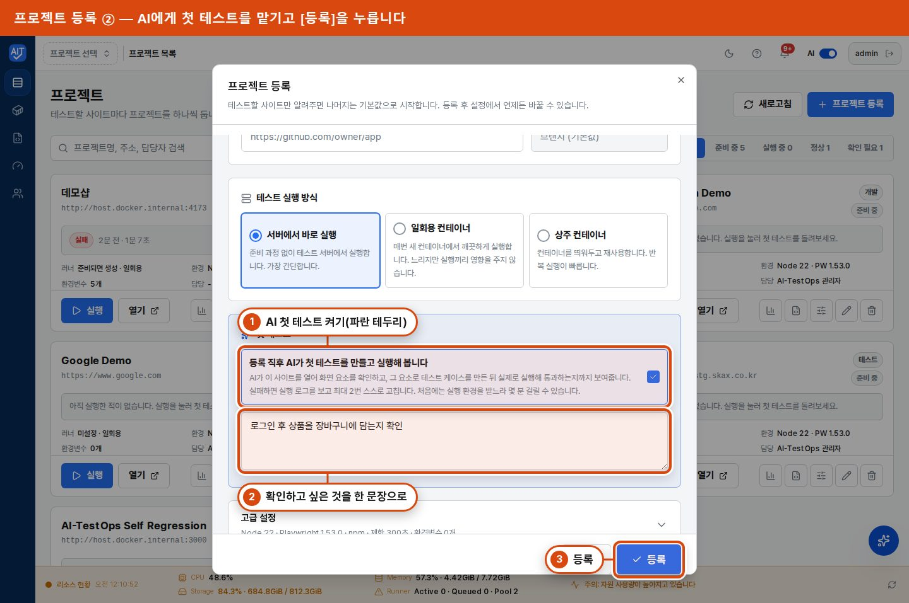

1. **AI 첫 테스트** 칸이 켜져 있어요. AI가 사이트를 둘러보고 첫 테스트를 만들어 줘요.
2. 확인하고 싶은 것을 한 문장으로 적어요.
3. **등록**을 눌러요. (사이트 주소와 이름은 [2장](#2-프로젝트-등록--ai가-첫-테스트까지)에서 설명해요.)

### ② 클릭으로 테스트 만들기
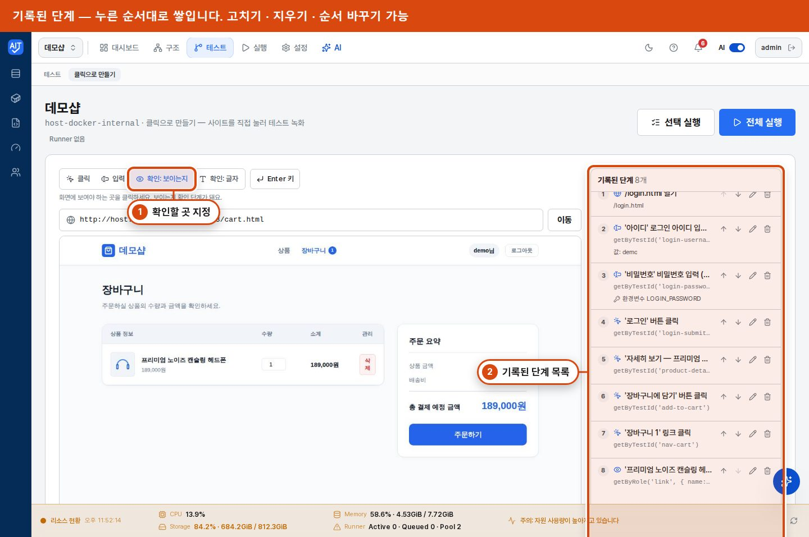

1. 사이트 화면에서 **확인할 곳 지정**을 고르고 보여야 하는 곳을 눌러요.
2. 지금까지 누른 동작이 오른쪽 **기록된 단계**에 쌓여요. 코드를 쓸 필요가 없어요.

### ③ 실행하기
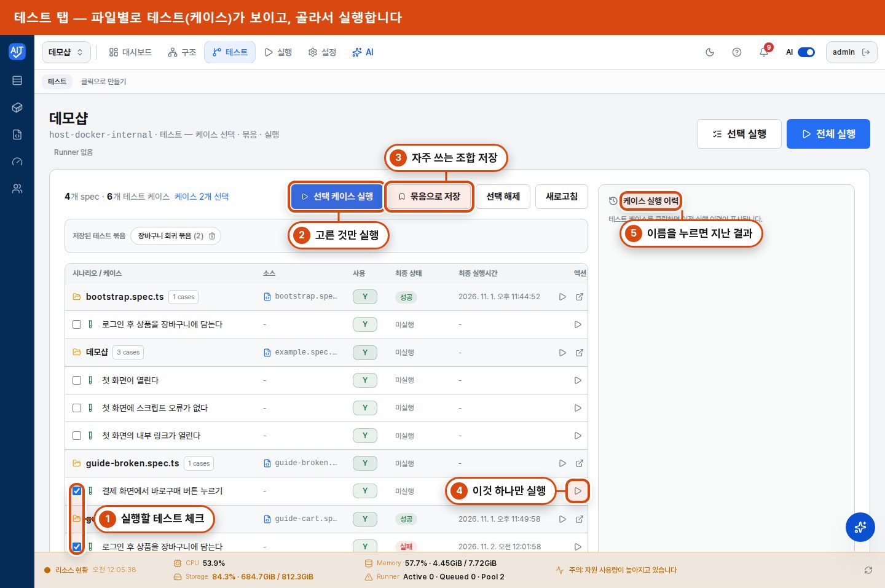

1. 실행할 테스트에 체크해요.
2. **선택 케이스 실행**을 눌러요.
3. 하나만 돌리려면 그 줄 오른쪽의 ▷를 눌러요.

### ④ 결과 보기
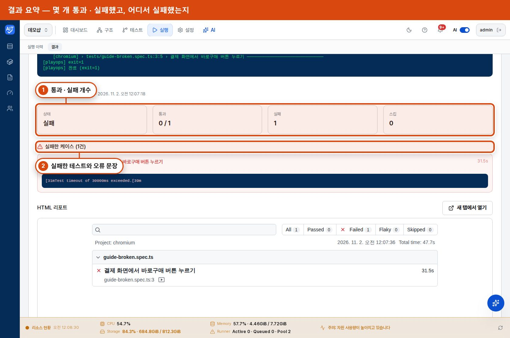

1. **통과 · 실패 개수**를 봐요. 초록은 통과, 빨강은 실패예요.
2. 실패했다면 **실패한 케이스**에서 어느 테스트가 왜 멈췄는지 읽어요.

---

## 용어 풀이

| 말 | 쉬운 뜻 |
|---|---|
| 프로젝트 | 테스트할 사이트 하나예요. 쇼핑몰이면 프로젝트 하나를 만들어요. |
| 테스트(케이스) | "로그인하면 상품이 보인다" 같은 확인 한 가지예요. |
| 테스트 파일(spec) | 테스트 여러 개를 담은 파일이에요. |
| 테스트 흐름 | 테스트 하나가 지나가는 화면의 순서예요. 로그인 → 상품 → 장바구니 같은 길이에요. |
| 실행 | 테스트를 실제로 한 번 돌리는 일이에요. 결과는 통과 또는 실패예요. |
| 셀렉터 | 화면에서 어떤 버튼인지 가리키는 이름표예요. **몰라도 돼요.** 도구가 알아서 붙여요. |
| 환경변수 | 테스트가 쓰는 계정 · 주소 같은 값을 따로 보관하는 곳이에요. 비밀번호는 가려져요. |
| 승인 | AI가 만든 변경을 사람이 확인하고 "반영해도 좋아요"라고 허락하는 일이에요. 승인 전에는 아무것도 바뀌지 않아요. |
| 아티팩트 | 실행이 남긴 자료예요. 스크린샷 · 동영상 · 로그 파일이 있어요. |
| Runner | 테스트를 돌리는 실행 상자(컨테이너)예요. |

---

## 1. 로그인과 프로젝트 목록

**이럴 때 쓰세요** — 처음 접속했을 때, 그리고 어떤 프로젝트가 있는지 볼 때.

### 로그인
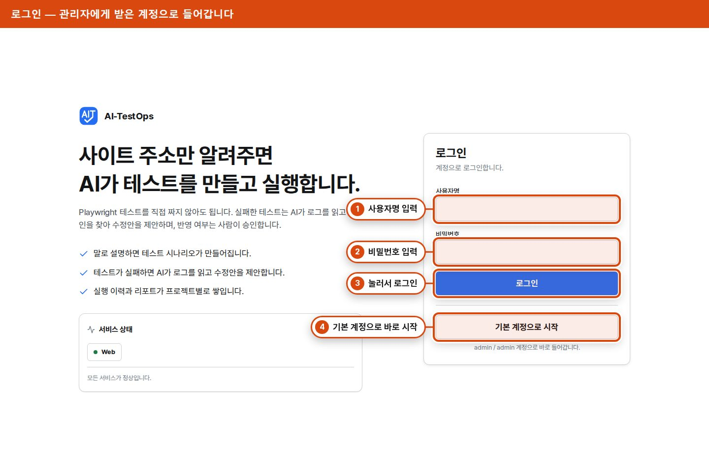

1. **사용자명**을 입력해요.
2. **비밀번호**를 입력해요.
3. **로그인**을 눌러요.

계정은 관리자에게 받아요. 로그인 카드 아래에는 **기본 계정으로 시작** 버튼도 있어요. 누르면 사진에 안내된 기본 계정으로 바로 들어가요.

⚠ **주의** — 기본 계정은 누구나 알 수 있는 값이에요. 운영 서버에서는 꼭 비밀번호를 바꾸세요. 바꾸는 방법은 [관리자 메뉴](#12-관리자-메뉴)의 사용자 관리에 있어요.

### 프로젝트 목록
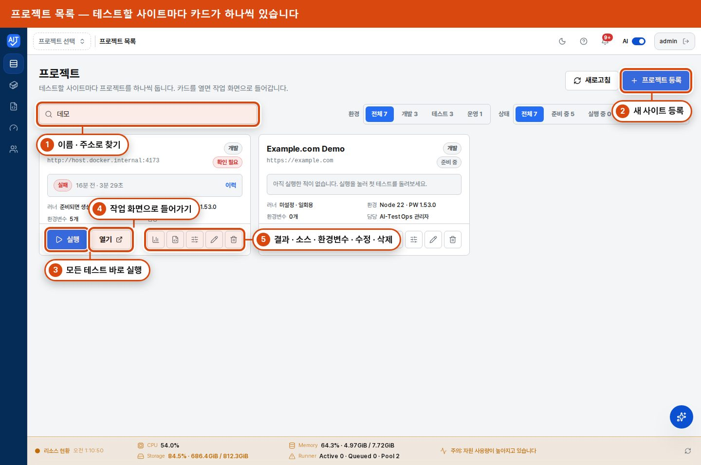

1. **검색창**에 이름이나 주소를 넣어 프로젝트를 찾아요.
2. **프로젝트 등록**으로 새 사이트를 추가해요.
3. **열기**를 누르면 그 프로젝트의 작업 화면으로 들어가요.
4. **실행**을 누르면 그 프로젝트의 모든 테스트를 바로 돌려요.
5. 오른쪽 작은 버튼들은 결과 · 소스 · 환경변수 · 수정 · 삭제예요.

💡 **팁** — 프로젝트가 아직 하나도 없으면 목록이 비어 있어요. 오른쪽 위 **프로젝트 등록**부터 시작하세요.

### 프로젝트 안의 화면
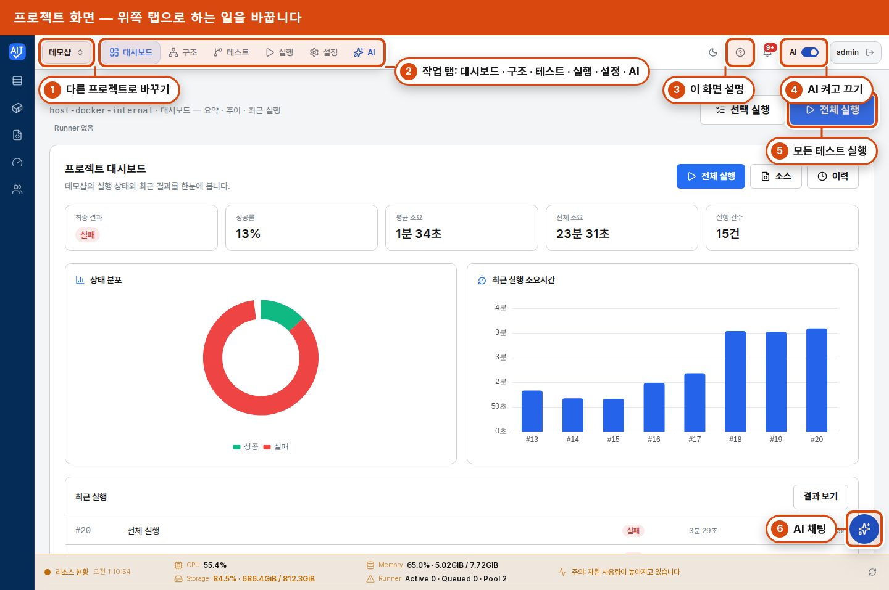

1. **프로젝트 이름 칸**을 누르면 다른 프로젝트로 바꿔요. (Ctrl + K)
2. **위쪽 탭**으로 하는 일을 바꿔요: 대시보드 · 구조 · 테스트 · 실행 · 설정 · AI.
3. **?** 버튼은 지금 화면의 설명을 보여 줘요.
4. **AI 스위치**로 AI 기능을 켜고 꺼요.
5. **전체 실행**은 이 프로젝트의 모든 테스트를 돌려요.
6. 오른쪽 아래 동그란 버튼은 **AI 채팅**이에요.

**자주 묻는 질문**
- **Q. 왼쪽 세로 줄은 뭐예요?** A. 프로젝트와 상관없이 쓰는 전체 메뉴예요. [12장](#12-관리자-메뉴)에서 설명해요.

---

## 2. 프로젝트 등록 — AI가 첫 테스트까지

**이럴 때 쓰세요** — 새 사이트를 처음 테스트할 때. 주소만 넣으면 AI가 첫 테스트까지 만들어 줘요.

### 사이트 주소와 이름
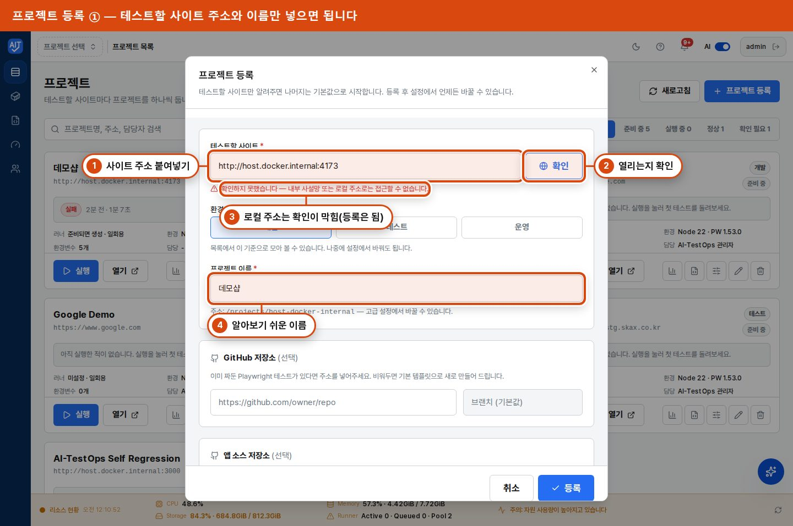

1. **테스트할 사이트** 칸에 주소를 붙여넣어요.
2. **확인**을 눌러 주소가 열리는지 봐요.
3. 결과가 나와요. 초록 글씨면 열린다는 뜻이에요. 같은 컴퓨터나 회사 안의 로컬 주소는 이 확인이 막혀도 등록은 돼요.
4. **프로젝트 이름**을 알아보기 쉽게 적어요.

### AI에게 첫 테스트 맡기기


1. **등록 직후 AI가 첫 테스트를 만들고 실행해 봅니다** 칸을 켜요. 파란 테두리가 켜진 상태예요.
2. 확인하고 싶은 것을 한 문장으로 적어요. 예: "로그인 후 상품을 장바구니에 담는지 확인"
3. **등록**을 눌러요. 실행 방식은 기본값 그대로 두면 돼요.

💡 **팁** — AI 스위치가 꺼져 있으면 이 칸 대신 기본 점검 테스트(첫 화면 · 스크립트 오류 · 내부 링크)가 만들어져요.

### 진행 창
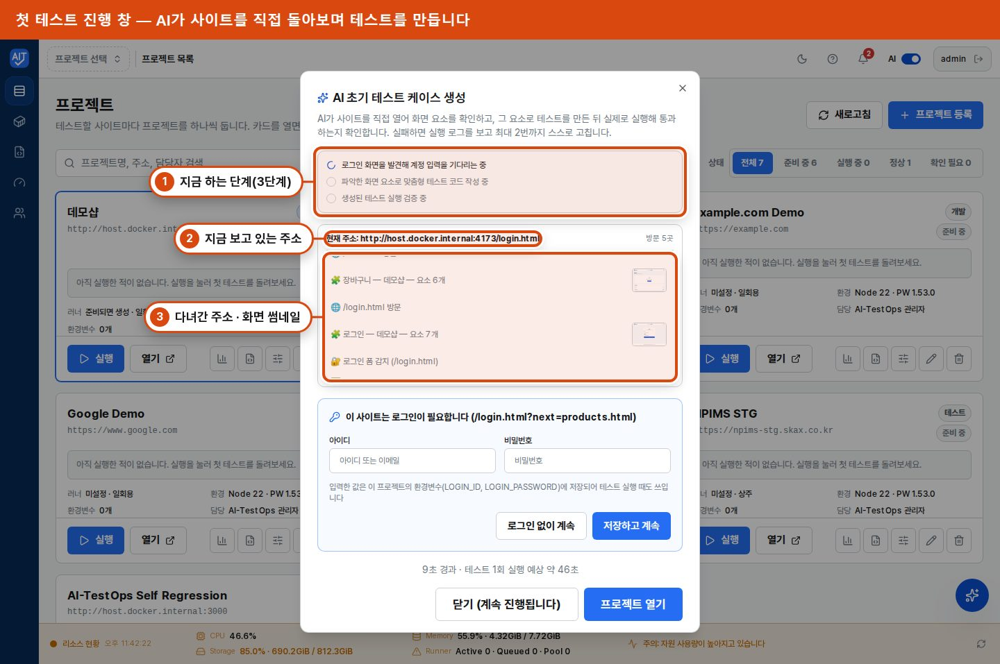

1. **세 단계**가 차례로 진행돼요: 사이트 둘러보기 → 테스트 코드 쓰기 → 실행해 확인하기.
2. AI가 **지금 보고 있는 주소**가 보여요.
3. **다녀간 주소와 화면 썸네일**이 쌓여요.

### 로그인 화면을 만나면
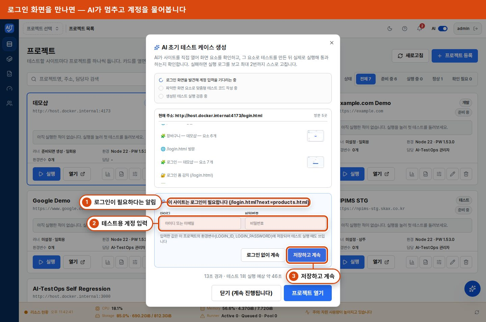

사이트에 로그인이 필요하면 AI가 멈추고 계정을 물어봐요.

1. **이 사이트는 로그인이 필요합니다** 알림이 떠요.
2. 테스트용 **아이디와 비밀번호**를 넣어요. 이 사이트의 데모 계정은 `demo` / `demo1234`예요.
3. **저장하고 계속**을 눌러요. 입력한 값은 이 프로젝트의 환경변수에 저장돼요.

로그인 없이 둘러보려면 **로그인 없이 계속**을 눌러도 돼요.

### 완료
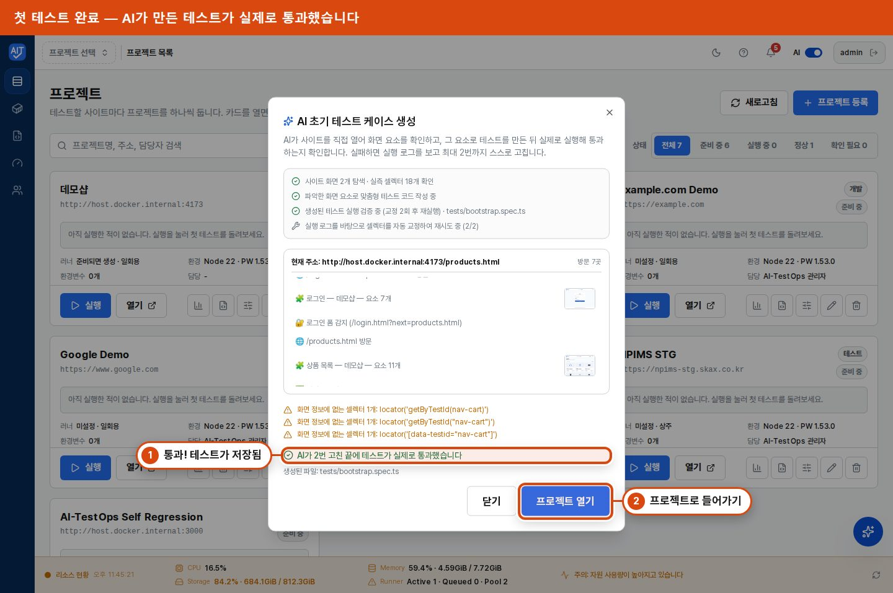

1. **AI가 만든 테스트가 실제로 통과했습니다** 문구가 보이면 성공이에요. 실패해도 AI가 최대 2번까지 스스로 고쳐 봐요.
2. **프로젝트 열기**를 눌러 작업 화면으로 가요.

⚠ **주의** — 처음에는 실행 환경을 받느라 몇 분 걸릴 수 있어요. 창을 닫아도 작업은 계속돼요. 결과는 실행 탭에서 볼 수 있어요.

**자주 묻는 질문**
- **Q. 등록한 뒤 이름이나 주소를 바꿀 수 있어요?** A. 네. 프로젝트 목록의 연필 버튼이나 설정 탭의 **설정 수정**에서 바꿔요.

---

## 3. 구조 탭 — 확인 지도

**이럴 때 쓰세요** — 사이트의 화면 중 어디까지 테스트로 확인했고, 어디서 막혔는지 한눈에 보고 싶을 때.

### 요약
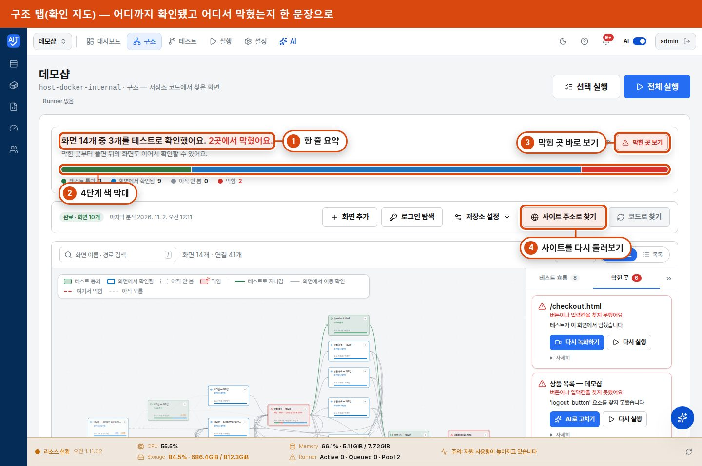

1. **한 줄 요약**이 먼저 나와요. 예: "화면 6개를 찾았어요. 1곳에서 막혔어요."
2. **색 막대**는 화면의 상태를 비율로 보여 줘요.
3. **막힌 곳 보기**를 누르면 막힌 이유로 바로 가요.
4. **사이트 주소로 찾기**는 사이트를 다시 둘러보고 화면을 새로 모아요.

### 지도
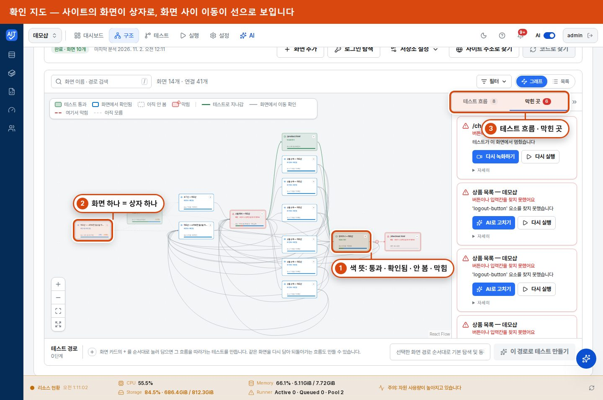

1. **색의 뜻**이에요: 테스트 통과(초록) · 화면에서 확인됨(파란 테두리) · 아직 안 봄(점선) · 막힘(빨강). 선은 화면 사이 이동이에요.
2. **상자 하나가 화면 하나**예요. 상자를 누르면 자세한 내용이 나와요.
3. 오른쪽 **테스트 흐름 · 막힌 곳** 탭으로 목록을 바꿔요.

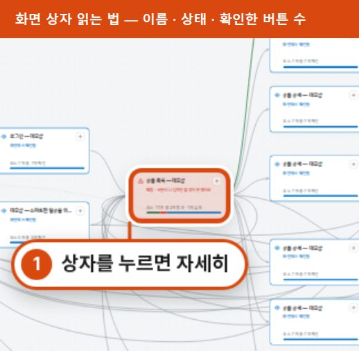

1. 상자에는 화면 이름 · 상태 · 확인한 버튼 수가 적혀 있어요.

### 테스트 흐름과 재생
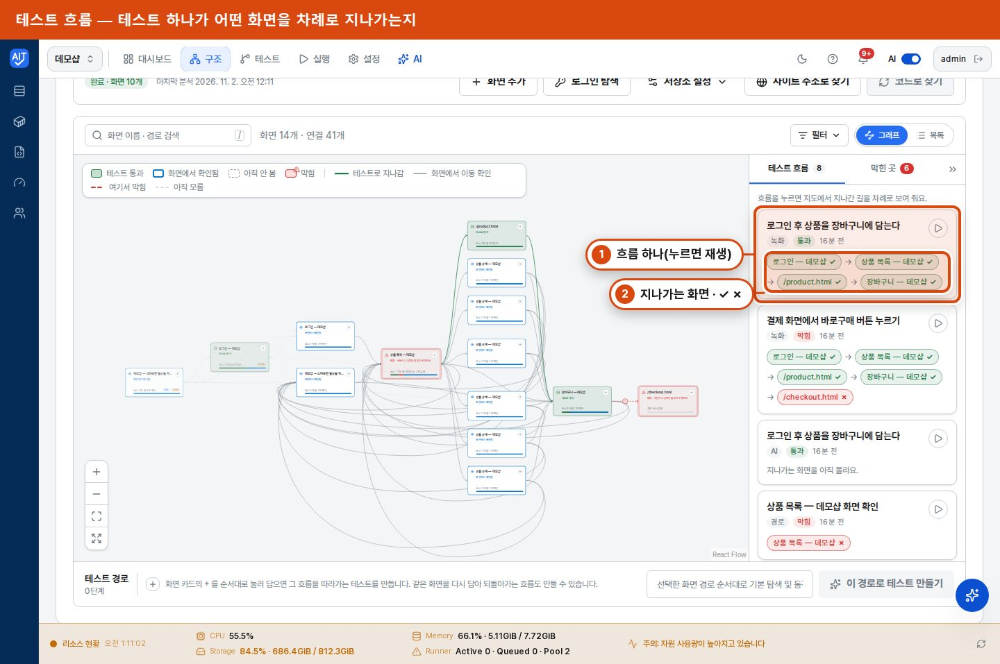

1. 흐름 카드 하나가 테스트 하나예요. 누르면 지도에서 그 길을 보여 줘요.
2. 지나가는 화면 옆의 ✓는 통과, ✗는 실패예요.

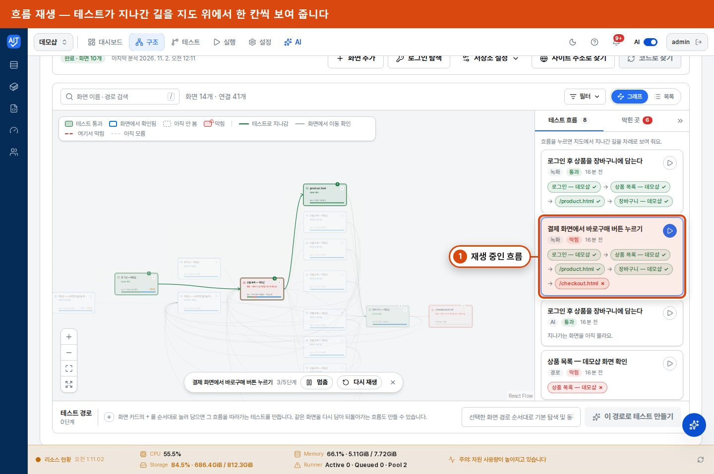

1. 재생 중인 흐름이 강조돼요. 지도 위에서 한 칸씩 지나가고, 실패한 곳에서 멈춰요.

### 막힌 곳
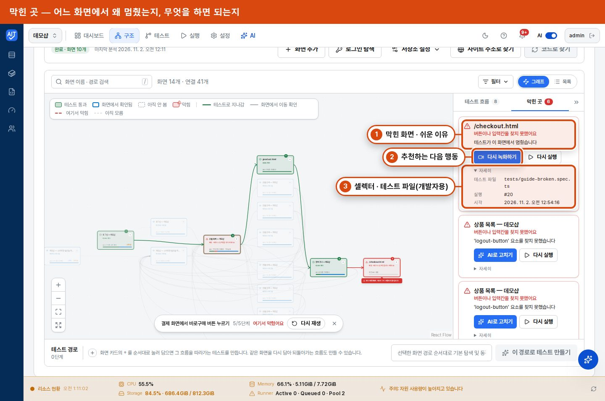

1. **막힌 화면과 쉬운 이유**가 적혀 있어요. 예: "버튼이나 입력칸을 찾지 못했어요".
2. **추천하는 다음 행동** 버튼이 있어요. 예: 다시 녹화하기, 다시 실행.
3. **자세히**를 열면 셀렉터와 테스트 파일이 보여요. 개발자용 정보라서 몰라도 돼요.

### 사이트 주소로 찾기
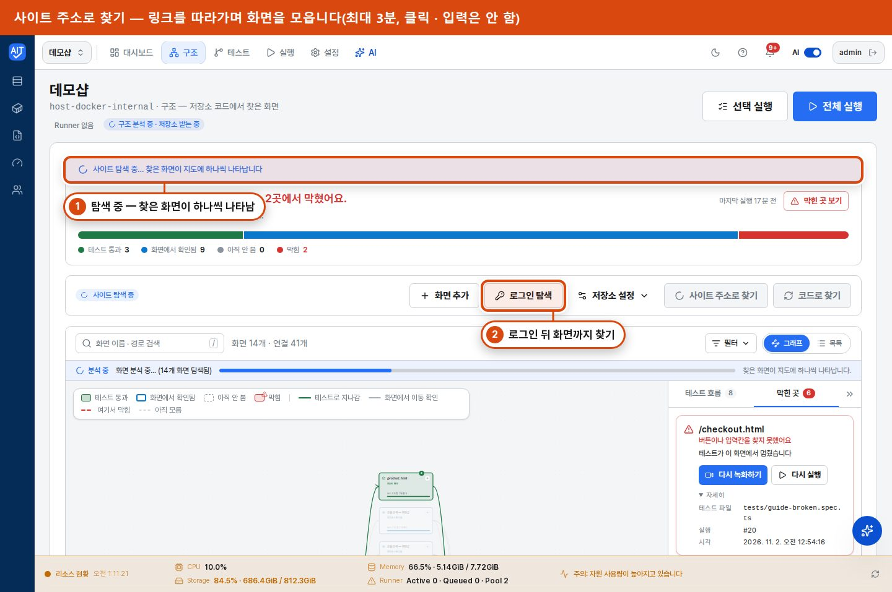

1. 탐색하는 동안 찾은 화면이 지도에 하나씩 나타나요. 최대 3분이 걸려요.
2. **로그인 탐색**을 쓰면 로그인한 뒤의 화면까지 찾아요.

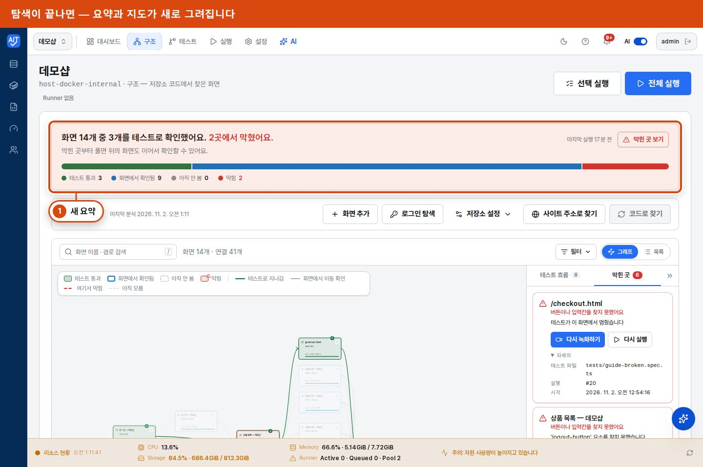

1. 끝나면 요약과 지도가 새로 그려져요.

⚠ **주의** — 사이트 탐색은 링크만 따라가요. 버튼을 누르거나 입력하지 않아요.

**자주 묻는 질문**
- **Q. "막힘"이 계속 남아요.** A. 막힌 곳 카드의 추천 행동을 따라 고친 뒤 테스트를 다시 실행하면 지도가 새로 바뀌어요.

---

## 4. 클릭으로 만들기 — 녹화

**이럴 때 쓰세요** — 코드를 쓰지 않고, 사이트를 직접 눌러 보여 주면서 테스트를 만들고 싶을 때. AI 없이 동작해요.

### 시작
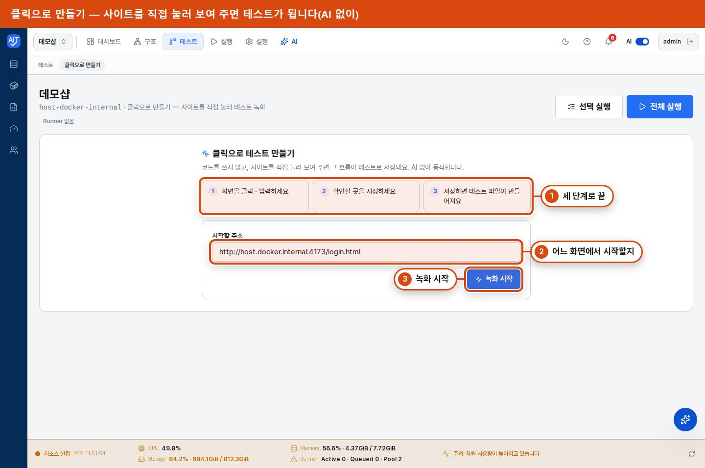

1. 사용 방법은 **세 단계**예요: 화면을 클릭 · 입력하기 → 확인할 곳 지정하기 → 저장하기.
2. **시작할 주소**를 정해요. 비워 두면 프로젝트 주소로 시작해요.
3. **녹화 시작**을 눌러요. 처음에는 브라우저를 준비하느라 30초쯤 걸려요.

### 입력하기
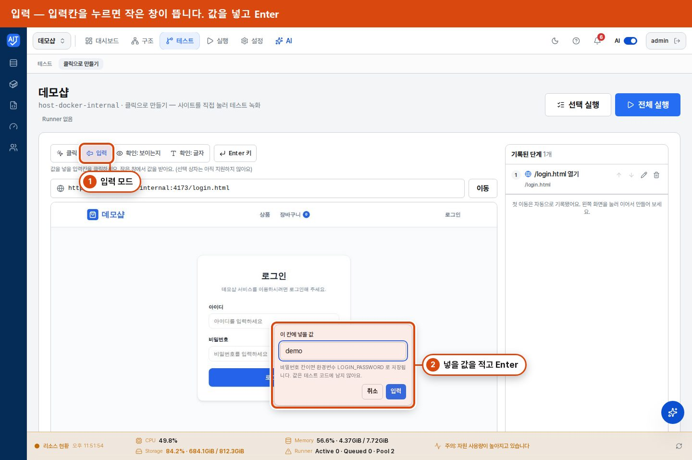

1. **입력** 모드를 골라요.
2. 입력칸을 누르면 작은 창이 떠요. 값을 넣고 Enter를 눌러요.

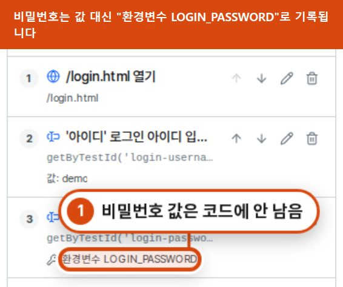

1. 비밀번호 칸은 값 대신 **환경변수 LOGIN_PASSWORD**로 기록돼요. 비밀번호가 테스트 코드에 남지 않아요.

### 마우스를 올려 보기
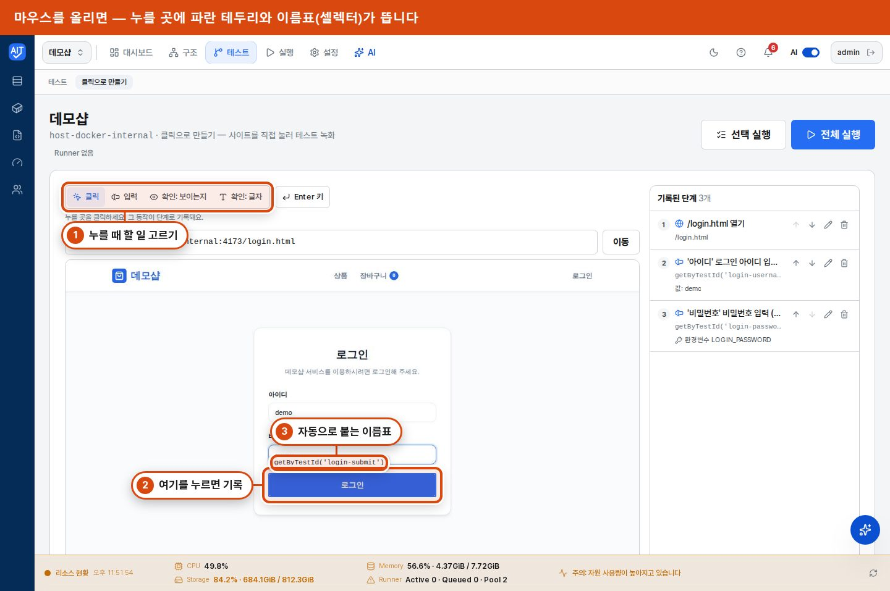

1. 위쪽에서 **누를 때 할 일**을 골라요: 클릭 · 입력 · 확인: 보이는지 · 확인: 글자.
2. 누를 곳에 마우스를 올리면 파란 테두리가 생겨요.
3. 테두리 위의 **이름표**가 도구가 붙인 셀렉터예요. 몰라도 돼요.

### 확인할 곳 지정


1. **확인: 보이는지**를 고르고 화면에 보여야 하는 곳을 눌러요. 눈 모양 단계가 생겨요.
2. 오른쪽 **기록된 단계**에서 고치기 · 지우기 · 순서 바꾸기를 할 수 있어요.

### 코드 보기와 저장
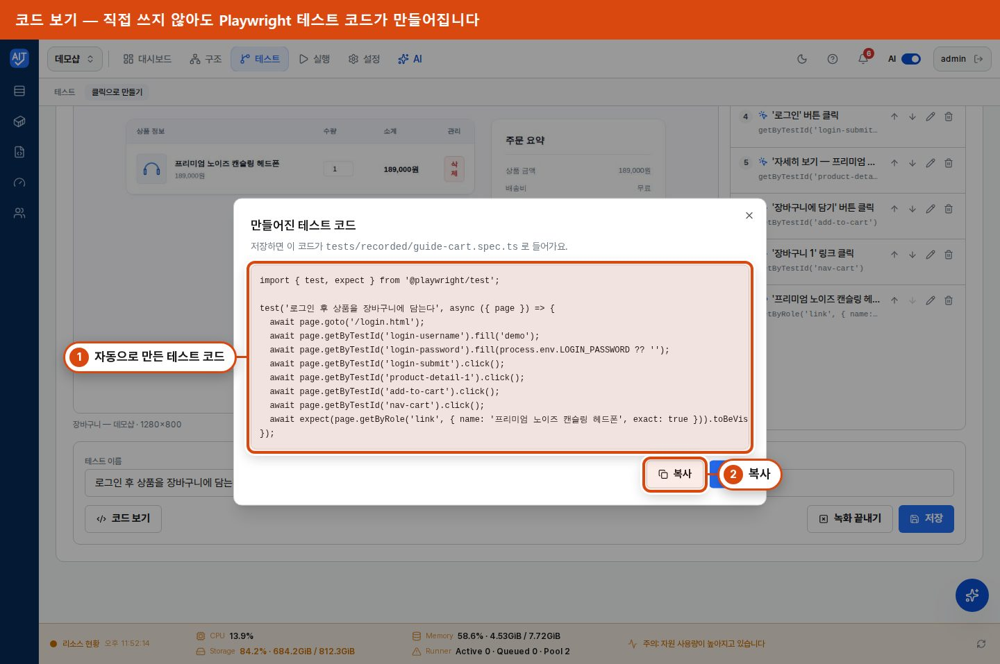

1. **코드 보기**를 누르면 자동으로 만든 테스트 코드가 보여요. 읽지 않아도 돼요.
2. **복사**로 코드를 가져갈 수 있어요.

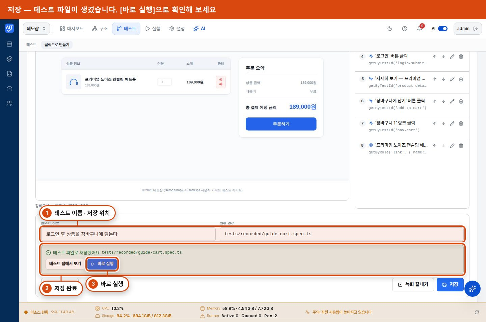

1. **테스트 이름**과 **저장 경로**를 적고 **저장**을 눌러요.
2. "테스트 파일로 저장했어요"가 보이면 끝이에요.
3. **바로 실행**을 누르면 방금 만든 테스트를 바로 돌려요.

💡 **팁** — 로그인이 필요한 사이트라면 로그인부터 눌러 보여 주세요. 로그인도 테스트의 한 단계가 돼요.

⚠ **주의** — 녹화 화면은 실제 사이트예요. 누른 내용이 그대로 실행돼요. 운영 사이트에서는 주문 같은 일을 조심하세요. 10분 동안 아무것도 안 하면 녹화가 자동으로 끝나요.

**자주 묻는 질문**
- **Q. 같은 이름으로 저장하면요?** A. 같은 경로에는 저장되지 않아요. 다른 경로로 저장하세요.

---

## 5. 테스트 탭

**이럴 때 쓰세요** — 만들어 둔 테스트를 보고, 골라서 실행하고, 자주 쓰는 조합을 묶어 둘 때.


1. 실행할 테스트 **앞의 칸에 체크**해요.
2. **선택 케이스 실행**을 눌러요. 체크한 것만 돌아요.
3. **묶음으로 저장**으로 자주 쓰는 조합에 이름을 붙여 둬요.
4. 줄 오른쪽 **▷**는 그 테스트 하나만 실행해요.
5. 오른쪽 **케이스 실행 이력**에는 테스트 이름을 누르면 지난 결과가 나와요.

### 묶음 저장
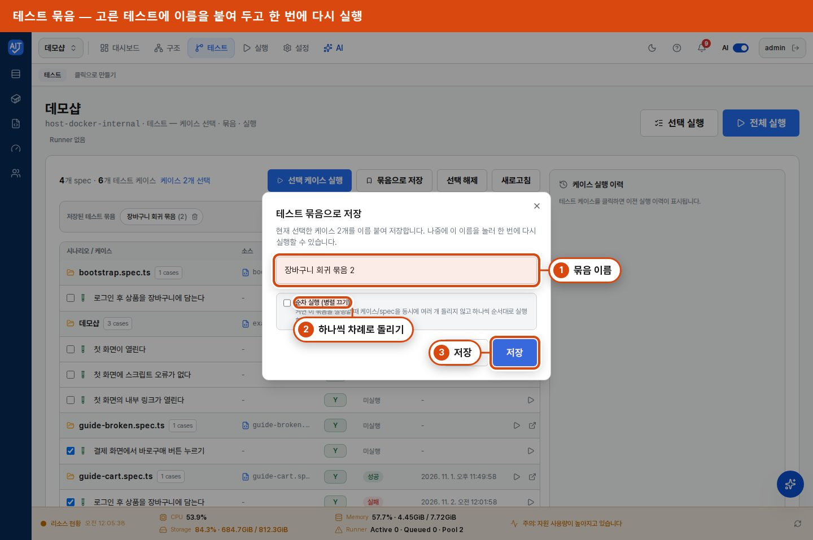

1. **묶음 이름**을 적어요.
2. **순차 실행**을 켜면 하나씩 차례로 돌려요.
3. **저장**을 눌러요. 저장한 묶음은 목록 위에 나타나고, 눌러서 한 번에 다시 돌릴 수 있어요.

### 케이스 실행 이력
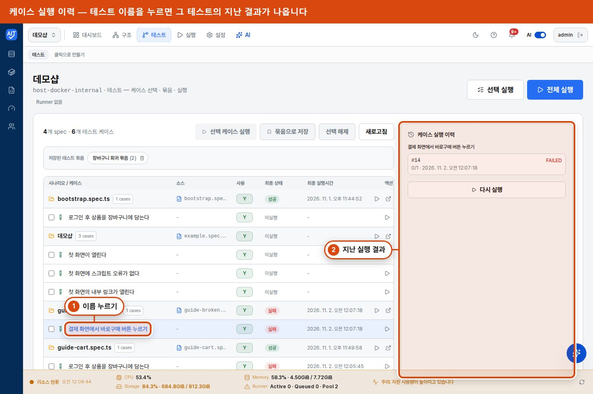

1. 테스트 **이름**을 눌러요.
2. 오른쪽에 그 테스트의 **지난 실행 결과**가 나와요.

💡 **팁** — 케이스 이력에는 ▷로 하나만 실행한 기록이 나와요. 여러 개를 한꺼번에 돌린 기록은 [실행 탭](#6-실행--결과--대시보드)에서 봐요.

**자주 묻는 질문**
- **Q. 새 테스트는 어떻게 추가해요?** A. [클릭으로 만들기](#4-클릭으로-만들기--녹화)나 [AI로 만들기](#8-ai-탭--ai로-만들기--ai-분석--ai-검토)로 만들어요.

---

## 6. 실행 · 결과 · 대시보드

**이럴 때 쓰세요** — 테스트가 지금 어떻게 돌고 있는지, 끝난 뒤 무엇이 통과하고 실패했는지 볼 때.

### 실행 중
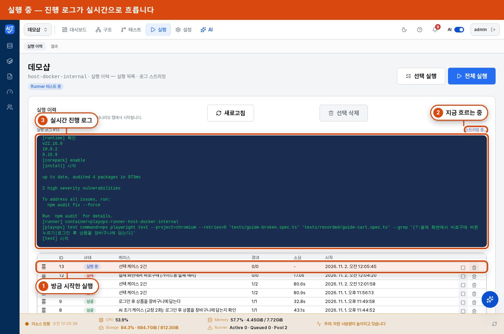

1. **방금 시작한 실행**이 목록 맨 위에 "실행 중"으로 나타나요.
2. **스트리밍 중**이라는 표시는 로그가 아직 흐르고 있다는 뜻이에요.
3. 위쪽 **진행 로그**가 실시간으로 쌓여요. 영어가 많아도 걱정하지 마세요. 끝나면 결과 탭에서 쉬운 요약을 봐요.

### 실행 이력
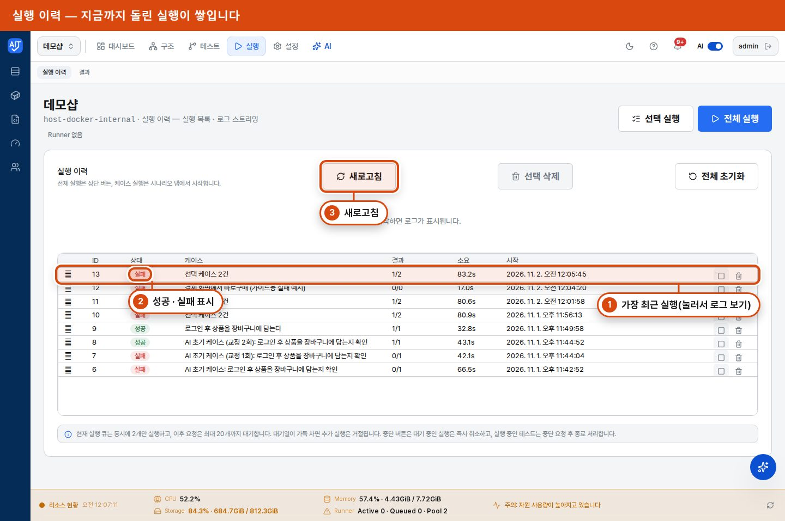

1. 가장 최근 실행이 맨 위에 있어요. 줄을 누르면 그 실행의 로그가 보여요.
2. **성공 · 실패** 표시로 결과를 한눈에 알아요.
3. **새로고침**으로 목록을 다시 불러요.

### 결과 탭
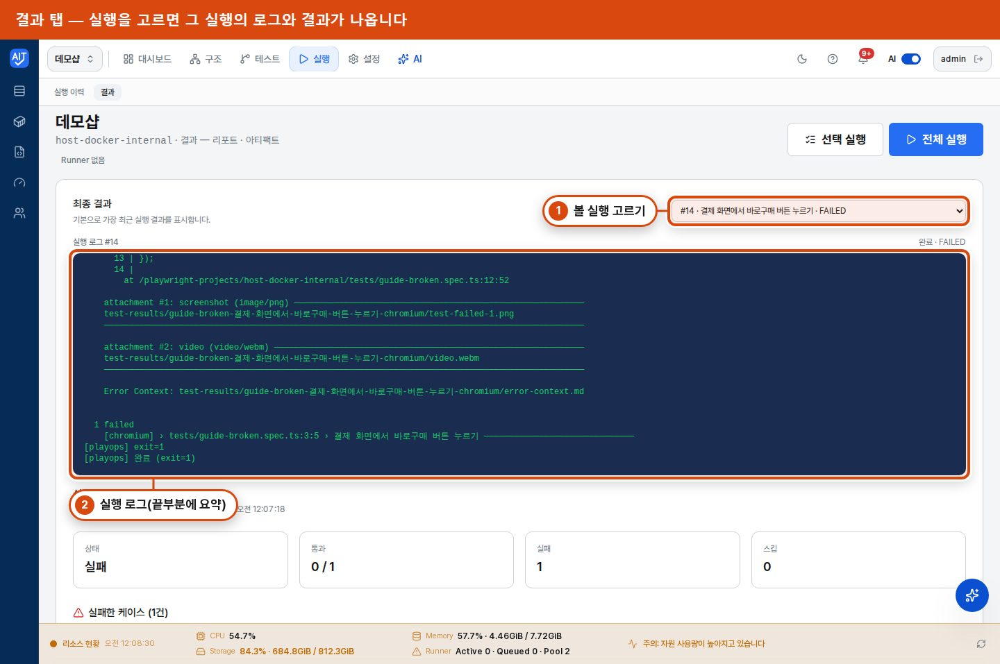

1. **볼 실행**을 골라요. 기본은 가장 최근 실행이에요.
2. 로그의 **끝부분**에 몇 개가 통과 · 실패했는지 요약돼요.


1. **통과 · 실패 개수** 카드를 봐요.
2. **실패한 케이스**에 실패한 테스트 이름과 오류 문장이 나와요.

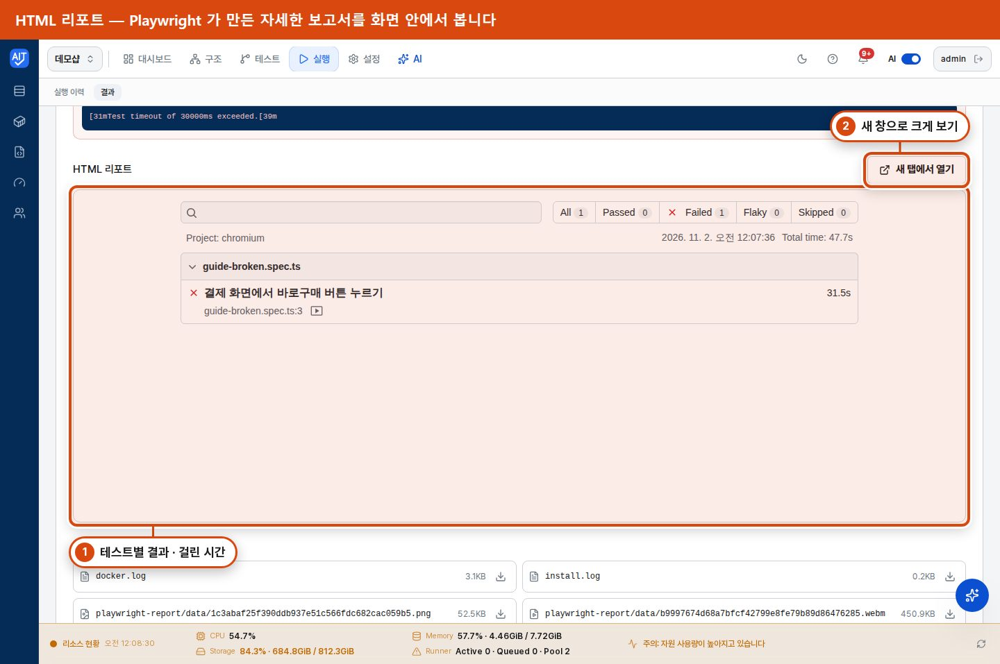

1. 화면 안에서 Playwright가 만든 **자세한 보고서**를 봐요. 테스트별 결과와 걸린 시간이 나와요.
2. **새 탭에서 열기**로 크게 볼 수 있어요.

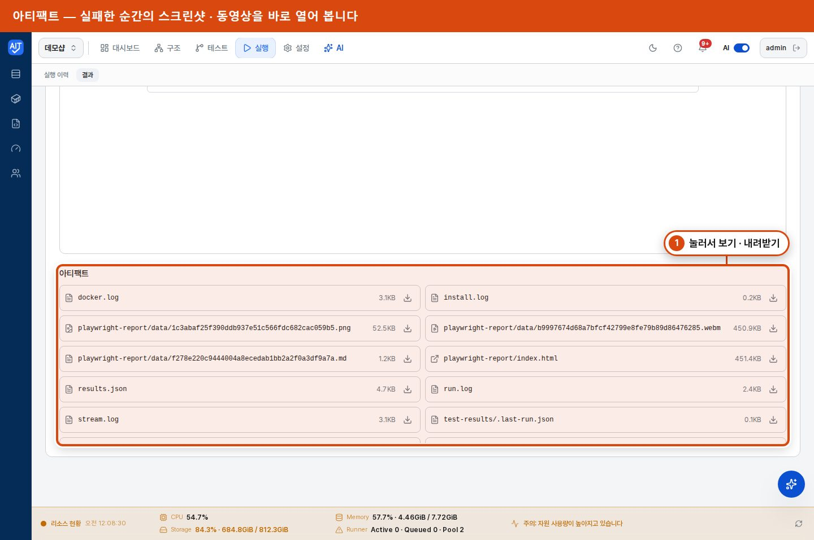

1. **아티팩트**를 누르면 스크린샷과 동영상을 바로 열어 볼 수 있고, 내려받기 아이콘으로 저장해요.

💡 **팁** — 실패한 순간의 스크린샷을 먼저 열어 보세요. 어느 화면에서 멈췄는지 가장 빨리 알 수 있어요.

### 대시보드
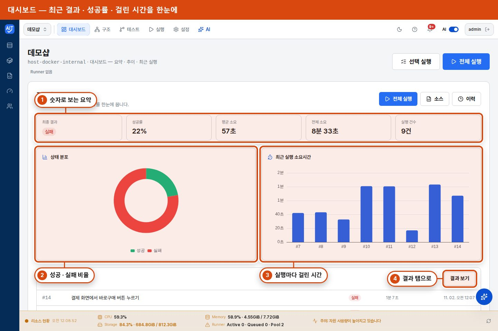

1. **숫자 요약**: 최종 결과 · 성공률 · 평균 소요 · 전체 소요 · 실행 건수예요.
2. **상태 분포**: 성공과 실패의 비율이에요.
3. **최근 실행 소요시간**: 실행마다 얼마나 걸렸는지 막대로 보여 줘요.
4. **결과 보기**를 누르면 결과 탭으로 가요.

**자주 묻는 질문**
- **Q. 실행 이력을 지우고 싶어요.** A. 실행 탭에서 줄을 고르고 **선택 삭제**, 전부 지우려면 **전체 초기화**를 눌러요.

---

## 7. AI 켜고 끄기

**이럴 때 쓰세요** — AI 기능이 필요 없거나, 잠깐 끄고 싶을 때. 끄면 화면은 그대로이고 AI 기능만 사라져요.

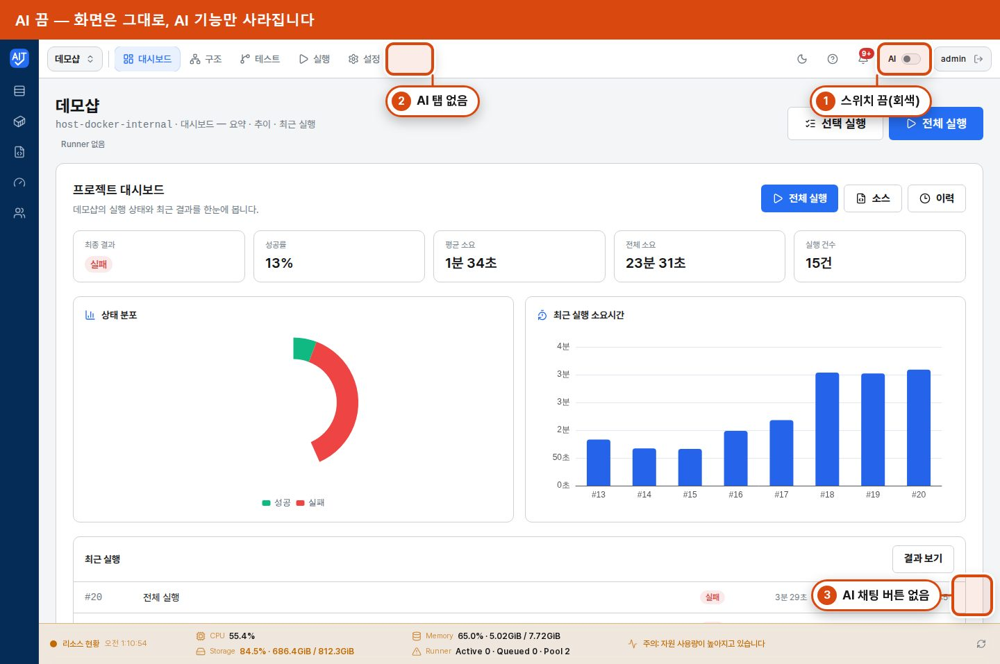
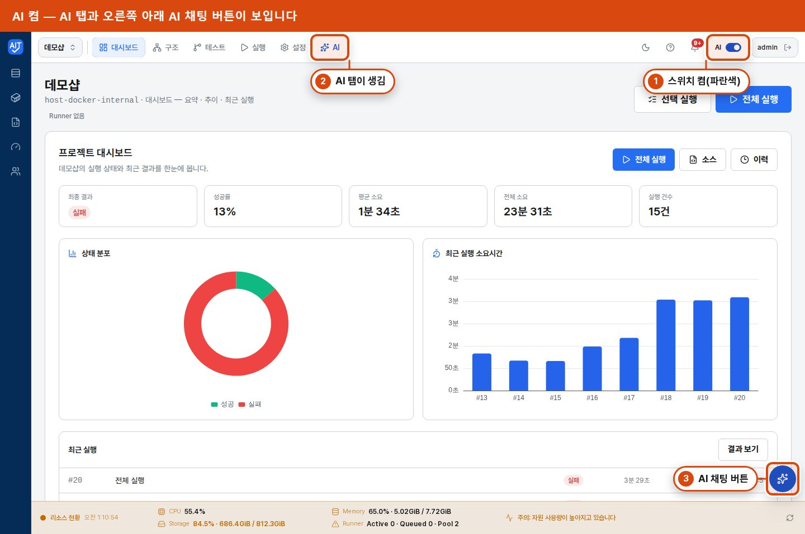

1. 위쪽 오른쪽의 **AI 스위치**를 눌러요. 켜면 파란색, 끄면 회색이에요.
2. 켜면 위쪽 탭에 **AI 탭**이 생겨요.
3. 켜면 오른쪽 아래에 **AI 채팅 버튼**이 생겨요.

| | AI 끔 | AI 켬 |
|---|---|---|
| 위쪽 탭 | 대시보드 · 구조 · 테스트 · 실행 · 설정 | 여기에 **AI** 탭이 더해져요 |
| 오른쪽 아래 | 아무것도 없어요 | **AI 채팅** 버튼이 있어요 |
| 프로젝트 등록 | 기본 점검 테스트가 만들어져요 | AI가 첫 테스트를 만들어요 |
| 코드 편집기 | 직접 고치기만 가능해요 | **AI 수정 도움** 버튼이 더해져요 |
| 클릭으로 만들기 · 실행 · 결과 | 똑같이 써요 | 똑같이 써요 |

⚠ **주의** — AI 스위치가 켜지지 않으면 관리자가 AI 키를 아직 등록하지 않은 거예요. [관리자 메뉴](#12-관리자-메뉴)를 보세요.

---

## 8. AI 탭 — AI로 만들기 · AI 분석 · AI 검토

AI를 켜야 보이는 탭이에요. **AI가 만든 변경은 사람이 승인해야만 반영돼요.**

### AI로 만들기
**이럴 때 쓰세요** — 코드를 모르지만 "이걸 확인해 줘"를 말로 시키고 싶을 때.

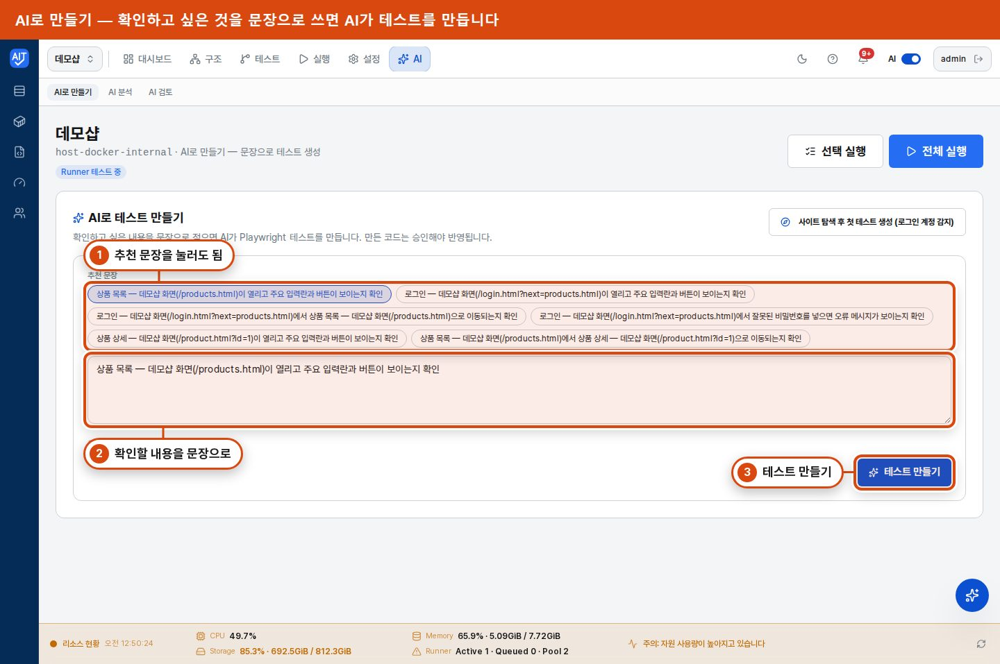

1. **추천 문장**을 눌러 골라도 돼요. 사이트에서 찾은 화면을 바탕으로 만든 문장이에요.
2. 확인하고 싶은 것을 **문장으로** 적거나 고친 문장을 다듬어요.
3. **테스트 만들기**를 눌러요.

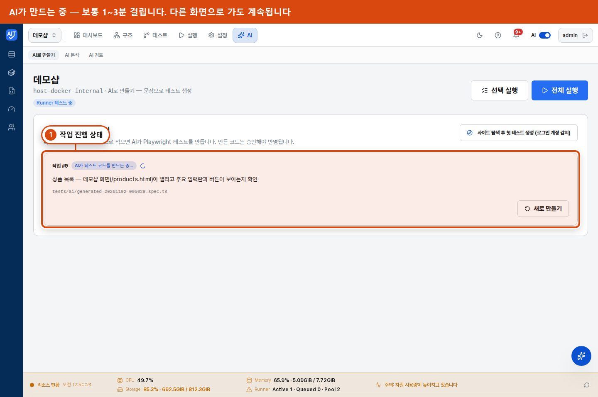

1. **작업 번호와 진행 상태**가 나와요. 다른 화면으로 가도 계속돼요.

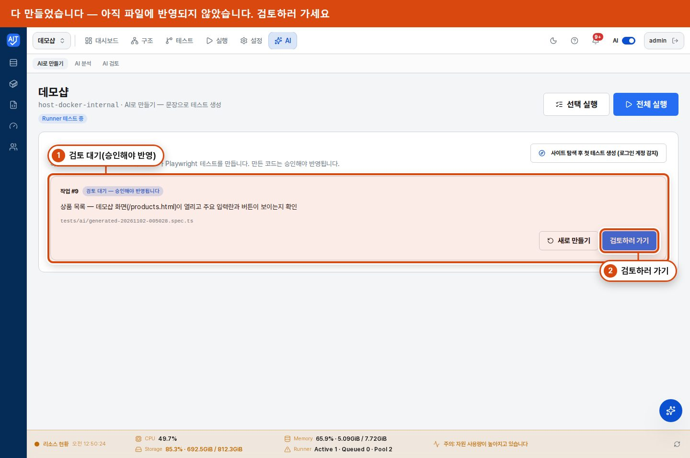

1. **검토 대기** 상태가 되면 다 만든 거예요. 아직 파일에 반영되지는 않았어요.
2. **검토하러 가기**를 눌러요.

### AI 검토
**이럴 때 쓰세요** — AI가 만든 코드를 보고 반영할지 정할 때.

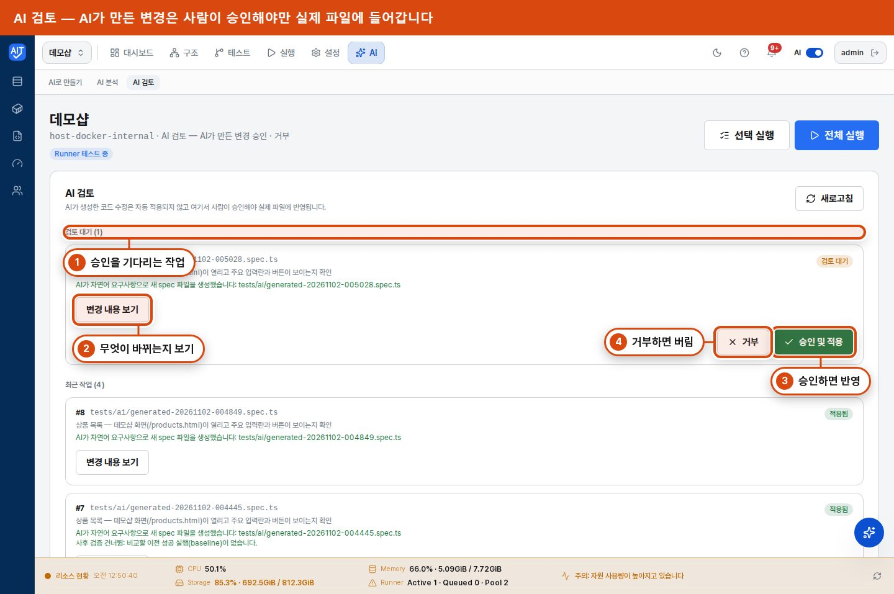

1. **검토 대기** 작업이 위쪽에 보여요.
2. **변경 내용 보기**로 무엇이 바뀌는지 펼쳐요.
3. 괜찮으면 **승인 및 적용**을 눌러요.
4. 아니면 **거부**를 눌러요. 거부하면 아무것도 바뀌지 않아요.

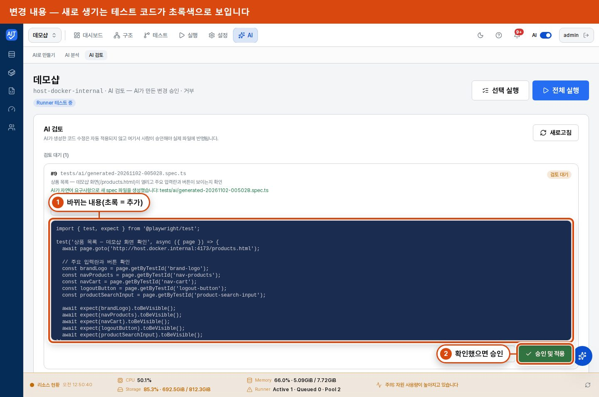

1. 새로 생기는 테스트 코드가 보여요. 코드를 읽기 어려우면 위의 한 줄 설명만 읽어도 돼요.
2. 확인했으면 **승인 및 적용**을 눌러요.

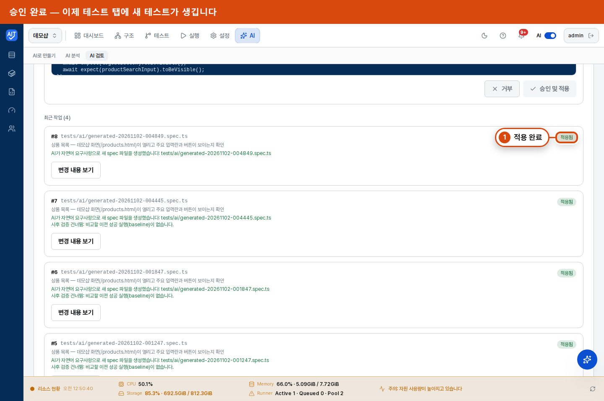

1. 승인하면 **적용 완료**가 돼요. 적용 뒤에는 확인 실행이 한 번 더 돌 수 있어요. 이제 테스트 탭에 새 테스트가 생겨요.

### AI 분석
**이럴 때 쓰세요** — 테스트가 실패했는데 이유를 쉬운 말로 듣고 싶을 때.

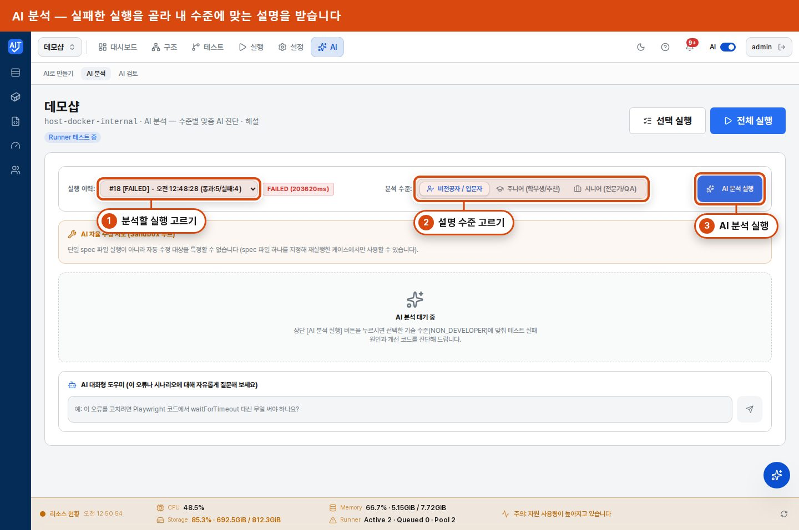

1. **분석할 실행**을 골라요. 실패한 실행을 고르면 좋아요.
2. **설명 수준**을 골라요: 비전공자 · 주니어 · 시니어.
3. **AI 분석 실행**을 눌러요.

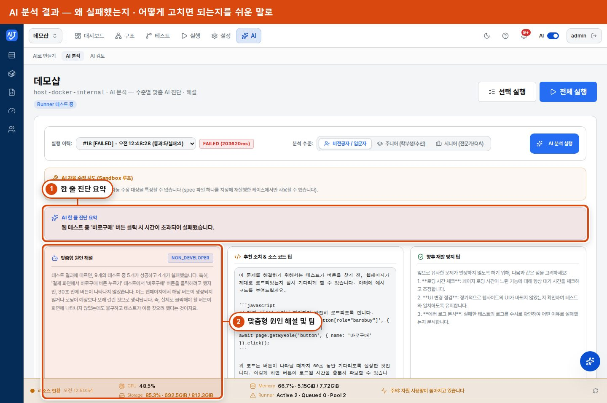

1. 왜 실패했는지와 어떻게 고치면 되는지가 고른 수준에 맞게 나와요.

💡 **팁** — 처음이라면 **비전공자**를 고르세요. 용어를 풀어서 설명해 줘요.

**자주 묻는 질문**
- **Q. AI가 만든 걸 승인하면 바로 위험하지 않아요?** A. 승인 전에는 파일이 바뀌지 않아요. 승인한 변경도 적용 뒤에 한 번 더 확인 실행을 해요.

---

## 9. AI 채팅

**이럴 때 쓰세요** — 짧게 물어보거나, 말로 일을 시키고 싶을 때. 어느 화면에서나 쓸 수 있어요.

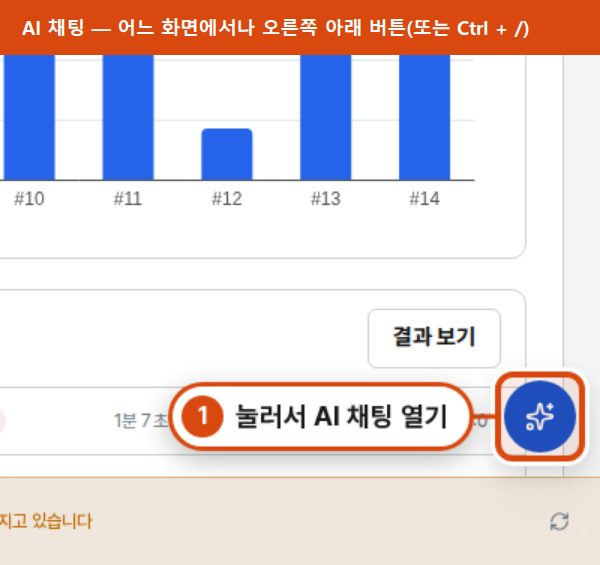

1. 오른쪽 아래 **동그란 버튼**을 눌러요. 단축키는 Ctrl + /예요.

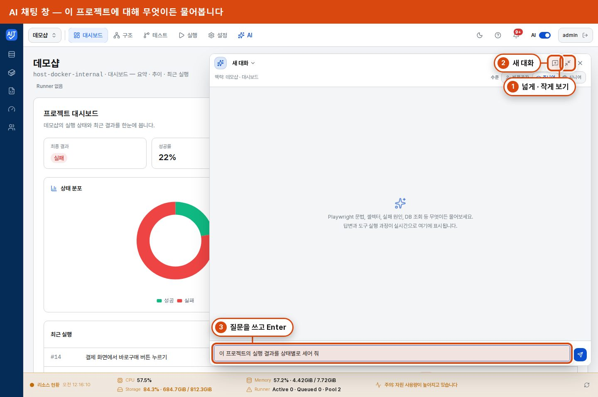

1. **넓게 보기 · 작게 보기**로 창 크기를 바꿔요.
2. **새 대화**를 눌러 새로 시작해요.
3. 아래 입력칸에 질문을 쓰고 Enter를 눌러요.

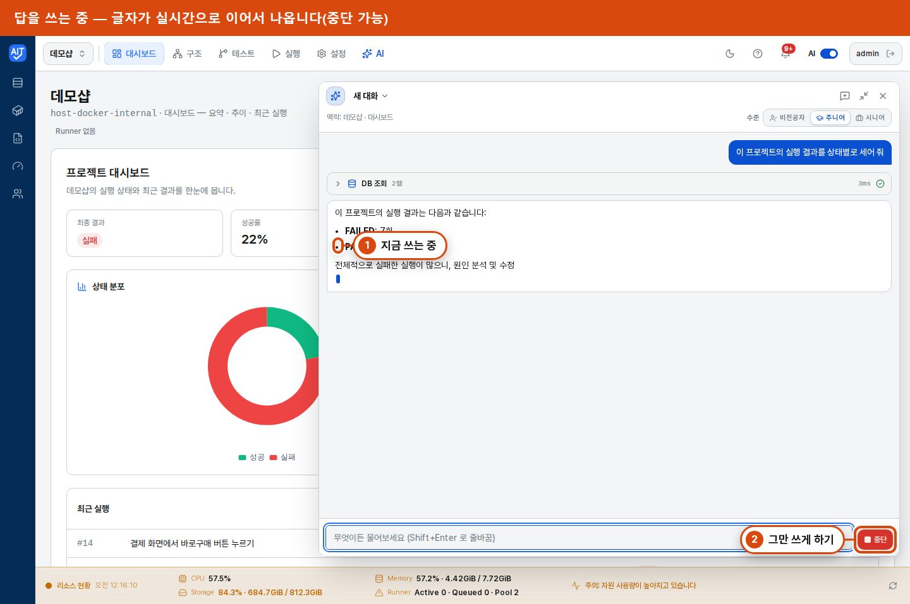

1. 답이 **실시간으로** 한 글자씩 이어서 나와요. 위쪽에 쓰는 중임을 알리는 표시가 있어요.
2. 마음에 안 들면 **중단**을 눌러 멈춰요.

### 질문 ① 실행 결과를 상태별로 세어 줘
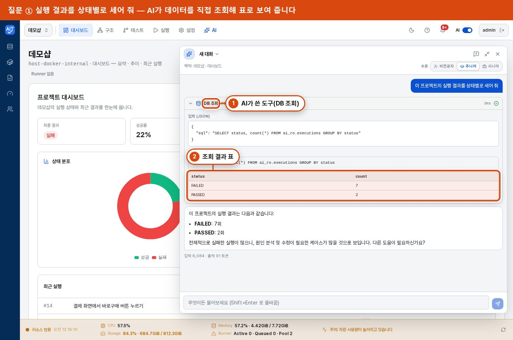

1. AI가 **DB 조회 도구**를 써요. 어떤 질문으로 조회했는지 펼쳐서 볼 수 있어요.
2. 조회한 **결과 표**가 나와요. 그 아래에 쉬운 말로 정리해 줘요.

### 질문 ② 실패한 테스트를 다시 실행해 줘
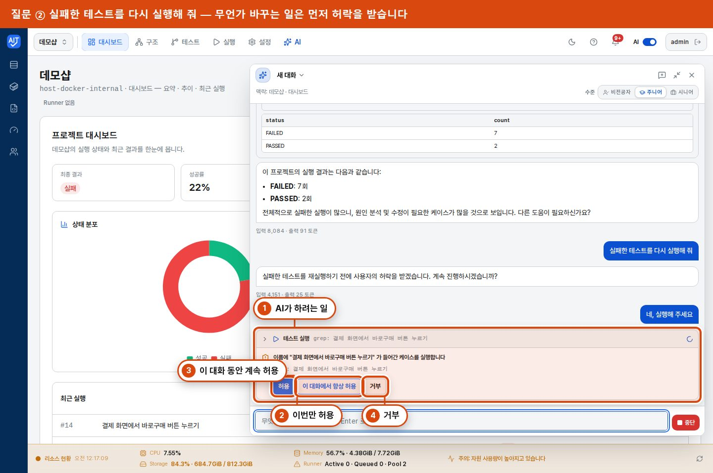

무언가를 바꾸거나 실행하는 일은 AI가 먼저 허락을 물어봐요.

1. **AI가 하려는 일**이 카드에 적혀 있어요.
2. **허용**: 이번 한 번만 허락해요.
3. **이 대화에서 항상 허용**: 이 대화 동안은 묻지 않고 해요.
4. **거부**: 하지 않아요.

AI가 먼저 글로 "실행할까요?"라고 되물으면 "네"라고 답해 주세요. 그러면 허락 카드가 나와요.

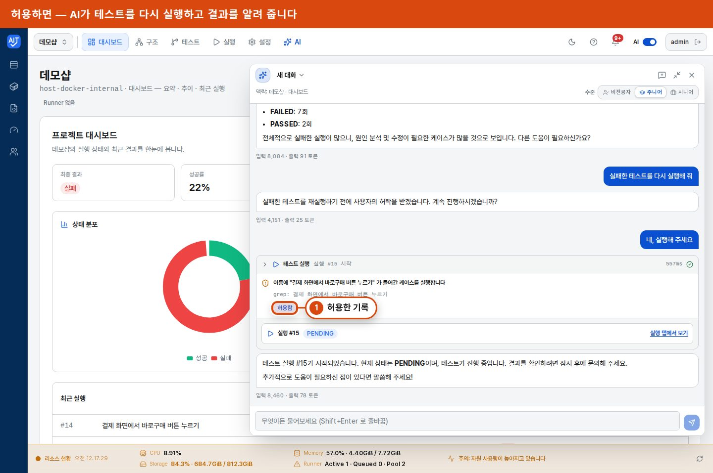

1. 허용하면 **허용함** 기록이 남고, AI가 실행한 뒤 결과를 알려 줘요.

💡 **팁** — "이 파일 고쳐 줘"처럼 파일 이름과 함께 요청하면 더 정확해요.

---

## 10. 설정

프로젝트의 기본값을 바꾸는 곳이에요. 위쪽 **설정** 탭 안에 **설정 · 예약 실행 · 코드 편집기** 세 가지가 있어요.

### 프로젝트 설정
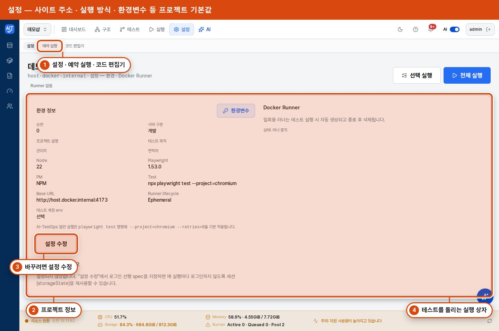

1. 위쪽의 **보조 탭**으로 설정 · 예약 실행 · 코드 편집기를 오가요.
2. **환경 정보** 카드에 사이트 주소 · 서버 구분 · 관리자 같은 기본 정보가 있어요.
3. **설정 수정**을 누르면 바꿀 수 있어요. 바꾼 값은 다음 실행부터 적용돼요.
4. **Docker Runner**는 테스트를 돌리는 실행 상자예요.

### 환경변수


1. **이름(KEY)**을 적어요. 예: LOGIN_ID
2. **비밀번호** 같은 값은 ●●●로 가려서 보관돼요.
3. 여러 개를 한 번에 넣으려면 **.env / JSON 붙여넣기**를 써요.

⚠ **주의** — 비밀번호 값은 화면에 다시 보여 주지 않아요. 사진을 찍거나 공유할 때도 환경변수 창은 조심하세요.

### 예약 실행
**이럴 때 쓰세요** — 매일 아침처럼 정해진 때 테스트가 저절로 돌게 하고 싶을 때.


1. **예약 이름**을 적어요.
2. 특정 테스트 파일만 돌리려면 경로를 적어요. 비우면 **전체**를 돌려요.
3. **몇 시에** 돌릴지 정해요. 서버 시각 기준이에요.
4. **무슨 요일에** 돌릴지 골라요. 아무것도 고르지 않으면 매일이에요.
5. **활성화**를 켜 두면 그 시각에 실행돼요.


1. 등록한 예약이 목록에 나타나요.
2. **예약 추가**로 더 만들 수 있어요.

### 코드 편집기
**이럴 때 쓰세요** — 테스트 파일을 직접 열어 고치고 싶을 때.


1. 왼쪽 **파일 탐색기**에서 파일을 골라요.
2. 오른쪽에서 코드를 고쳐요. 바뀐 줄이 표시돼요.
3. **저장**을 눌러야 반영돼요. 저장하지 않으면 사라져요.


1. AI를 켜면 **AI 수정 도움** 버튼이 생겨요. 열린 파일을 AI에게 고쳐 달라고 할 수 있어요. 결과는 에디터에 적용한 뒤 저장해야 반영돼요.

**자주 묻는 질문**
- **Q. 코드가 영어라서 어려워요.** A. 고치지 않아도 돼요. [클릭으로 만들기](#4-클릭으로-만들기--녹화)나 AI 도움으로 만드는 게 더 쉬워요.

---

## 11. 알림 · 도움말 · 프로젝트 전환

### 알림


1. 오른쪽 위 **종**의 빨간 숫자는 아직 안 본 알림 수예요.
2. 알림 하나를 누르면 해당 결과로 가요. 테스트 종료 · 예약 실행 완료 · 예약 실행 실패를 알려 줘요.
3. **모두 지우기**로 확인한 알림을 지워요.

### 도움말


1. 위쪽 **?** 버튼을 눌러요.
2. **지금 이 화면** 설명이 나와요. 화면마다 내용이 달라요.
3. **키보드 단축키**가 있어요: Ctrl + /는 AI 채팅, Ctrl + K는 프로젝트 전환이에요.

### 프로젝트 전환


1. Ctrl + K를 누르거나 프로젝트 이름 칸을 눌러요. 이름으로 찾아서 고르면 그 프로젝트로 가요.

---

## 12. 관리자 메뉴

왼쪽 세로 줄은 프로젝트와 상관없이 쓰는 **전체 메뉴**예요.


1. **프로젝트 목록**
2. **Runner 컨테이너**
3. **Playwright 템플릿**
4. **AI 설정 · 사용량**
5. **사용자 관리** (관리자만 보여요)

### AI 설정 · 사용량


1. **쓸 AI**를 골라요: Claude 또는 GPT. 모든 AI 기능이 여기서 고른 AI를 써요.
2. **사용 중** 표시가 지금 쓰는 AI예요. 키가 등록되지 않은 AI는 고를 수 없어요.
3. **단가**를 넣으면 쓴 비용을 추정해 줘요. 실제 청구액은 각 AI 회사 콘솔에서 확인하세요.


1. **기간**(7일 · 30일 · 90일)을 바꿔 볼 수 있어요.
2. **기능별**로 어디에 많이 썼는지 알 수 있어요.

⚠ **주의** — API 키 입력 칸은 이 가이드의 사진에 담지 않았어요. 키는 관리자만 등록하고, 등록한 키는 다시 보이지 않아요.

### 사용자 관리


1. **사용자 등록**으로 함께 쓸 사람의 계정을 만들어요.
2. **연필**을 눌러 역할이나 비밀번호를 바꿔요. 기본 계정의 비밀번호도 여기서 바꿔요.

### Runner 컨테이너


1. **Runner 현황**에서 지금 도는 실행 상자 수를 봐요.
2. **호스트/도커 현황**에서 서버의 CPU · 메모리를 봐요.
3. **미사용 Runner 삭제**로 안 쓰는 상자를 정리해요.

💡 **팁** — 실행이 멈춘 것 같으면 여기부터 확인하세요.

### Playwright 템플릿


1. 새 프로젝트를 만들 때 처음 깔리는 테스트 코드 묶음이에요. 기본 템플릿이 하나 있어요.

---

## 막혔을 때 이렇게 하세요

| 이런 일이 생기면 | 이렇게 하세요 |
|---|---|
| 등록 창의 **확인**이 "로컬 주소는 접근할 수 없습니다"라고 해요 | 같은 컴퓨터나 회사 안의 주소는 확인이 막혀요. 등록은 그대로 진행돼요. |
| 첫 테스트 진행 창에서 멈춰 있어요 | 로그인 정보를 묻는 카드가 아래에 떠 있는지 보세요. 계정을 넣고 **저장하고 계속**을 누르세요. |
| 처음 실행이 오래 걸려요 | 처음에는 실행 환경을 받느라 몇 분 걸려요. 창을 닫아도 계속돼요. |
| AI 스위치가 켜지지 않아요 | 관리자가 AI 키를 등록해야 해요. [AI 설정 · 사용량](#ai-설정--사용량)을 보세요. |
| 구조 탭에 **막힘**이 있어요 | **막힌 곳** 카드를 열고 추천 행동(다시 녹화하기 · 다시 실행)을 따라 하세요. |
| 결과에 오류 문장이 영어로 나와요 | **AI 분석**에서 설명 수준을 **비전공자**로 고르고 분석하세요. |
| 실패했는데 이유를 모르겠어요 | 결과 탭의 **스크린샷**을 열어 어느 화면에서 멈췄는지 보세요. |
| 로그인이 필요한 화면이 지도에 안 보여요 | 설정의 **환경변수**에 LOGIN_ID와 LOGIN_PASSWORD를 넣고 **로그인 탐색**을 쓰세요. |
| 케이스 실행 이력이 비어 있어요 | 그 테스트를 ▷로 하나만 실행해 보세요. 여러 개를 함께 돌린 기록은 실행 탭에 있어요. |
| 실행이 계속 대기해요 | **Runner 컨테이너** 화면에서 실행 상자 상태를 확인하세요. |
| 녹화가 시작되지 않아요 | **다시 시도**를 누르세요. 그래도 안 되면 처음으로 돌아가 다시 시작하세요. |

---

## 화면별 한 줄 요약

| 화면 | 한 줄 요약 |
|---|---|
| 로그인 | 계정으로 들어가요. |
| 프로젝트 목록 | 테스트할 사이트를 카드로 모아 둔 곳이에요. |
| 프로젝트 등록 | 주소만 넣으면 AI가 첫 테스트까지 만들어요. |
| 대시보드 | 최근 결과와 성공률을 숫자와 그림으로 봐요. |
| 구조 | 어디까지 확인했고 어디서 막혔는지 지도로 봐요. |
| 테스트 | 테스트를 골라 실행하고 묶음으로 저장해요. |
| 클릭으로 만들기 | 사이트를 눌러 보여 주면 테스트가 돼요. |
| 실행 이력 | 돌린 실행의 목록과 실시간 로그예요. |
| 결과 | 통과 · 실패, 리포트, 스크린샷을 봐요. |
| 설정 | 주소 · 환경변수 · 실행 방식을 바꿔요. |
| 예약 실행 | 정해진 시각에 저절로 돌려요. |
| 코드 편집기 | 테스트 파일을 직접 고쳐요. |
| AI로 만들기 | 문장으로 쓰면 AI가 테스트를 만들어요. |
| AI 분석 | 실패 이유를 내 수준에 맞게 설명해요. |
| AI 검토 | AI가 만든 변경을 사람이 승인해요. |
| AI 채팅 | 말로 묻고, 허락하면 일을 해 줘요. |
| AI 설정 · 사용량 | 쓸 AI를 고르고 사용량을 봐요. |
| 사용자 관리 | 계정과 역할을 관리해요. |
| Runner 컨테이너 | 테스트를 돌리는 실행 상자 상태예요. |
| Playwright 템플릿 | 새 프로젝트에 깔리는 기본 테스트 묶음이에요. |

---

## 이 가이드의 사진 다시 찍기

사진은 `scripts/`의 도구로 다시 찍을 수 있어요. 화면이 바뀌면 같은 방법으로 새로 찍어요.

```bash
docs/user-guide/scripts/run.sh          # 모든 사진
docs/user-guide/scripts/run.sh 07 08    # 장면 번호로 골라서
```

- 관리자 계정은 저장소의 `.env`에서 읽어요. 사진과 문서에는 남기지 않아요.
- 장면별로 어떤 사진을 찍는지는 `scripts/scenes/` 파일 맨 위 설명에 적혀 있어요.
- 화면 하나만 보고 싶으면 `run.sh --peek /projects`처럼 써요.
